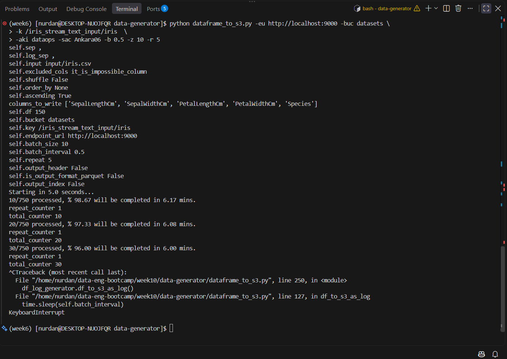
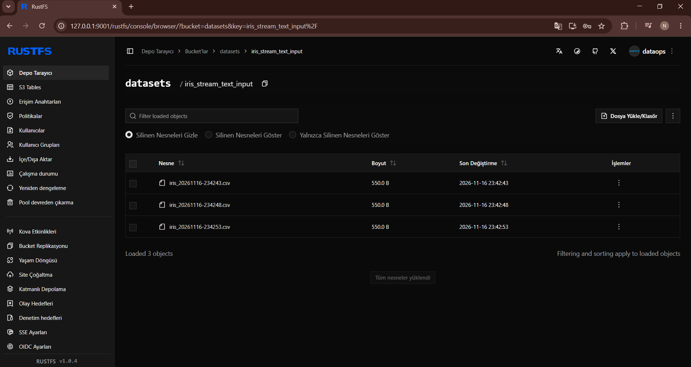
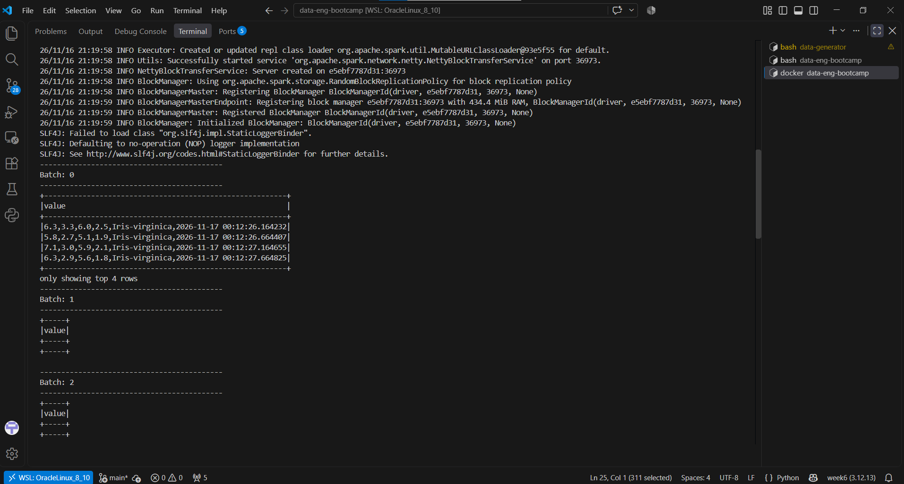
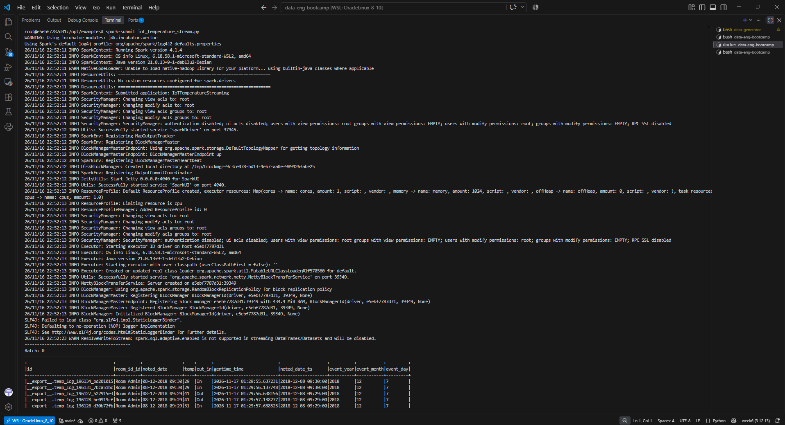
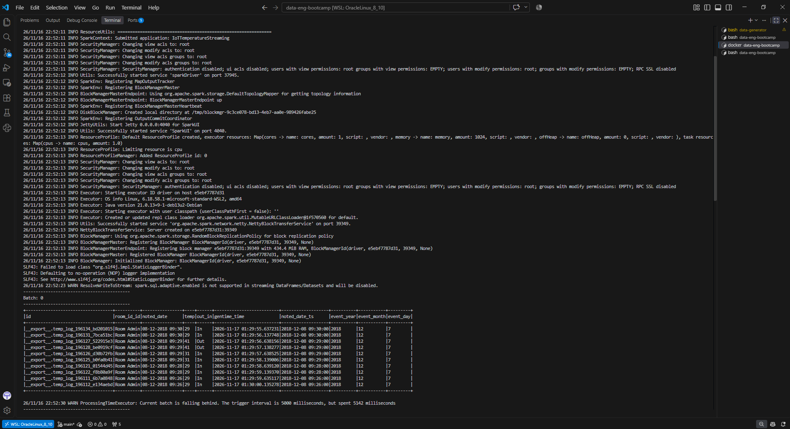
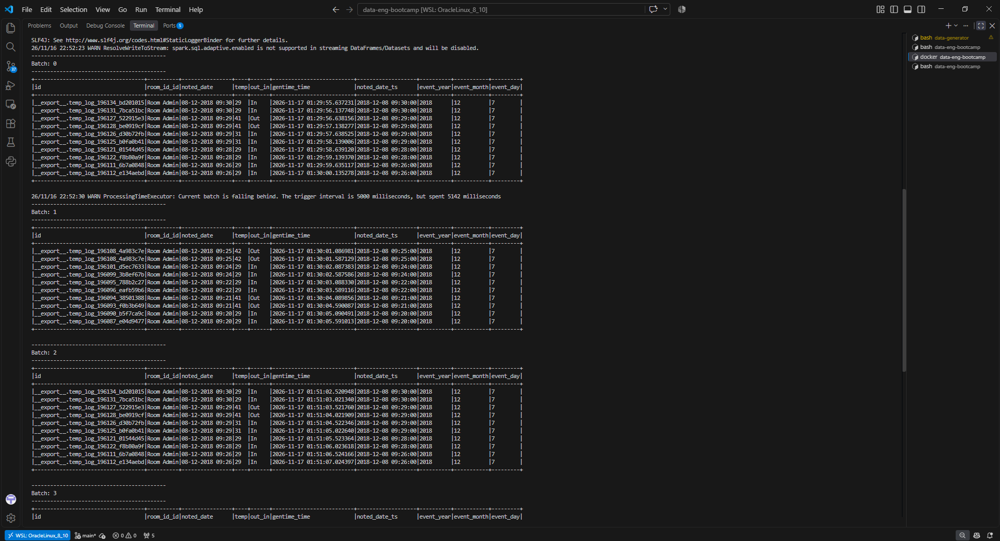

# Week 10 — Spark Performance Optimization & Structured Streaming

This week of the Data Engineering Bootcamp focused on optimizing Apache Spark applications and building streaming data pipelines with Spark Structured Streaming.

The hands-on exercises covered Spark caching, join optimization, data organization techniques, and incremental processing of files stored in an S3-compatible object store.

The environment uses **Apache Spark 4.1.4**, **PySpark**, **Docker**, and **RustFS**.

## Topics Covered

### 1. Spark Performance Optimization

#### Caching and Persistence

Caching allows Spark to reuse previously computed data instead of recomputing the same transformations.

Key operations:

- `cache()`: Caches a DataFrame using the default storage level.
- `persist()`: Allows the storage level to be specified explicitly.
- `unpersist()`: Removes cached or persisted data from Spark's storage.

Common storage levels include:

- `MEMORY_ONLY`
- `MEMORY_AND_DISK`
- `DISK_ONLY`

Caching is particularly useful when the same DataFrame is accessed repeatedly.

**Practice:** [01_cache.ipynb](01_cache.ipynb)

#### Join Strategies

Spark supports several physical join strategies.

| Join Strategy | Description | Typical Use Case |
|---------------|-------------|------------------|
| Broadcast Hash Join (BHJ) | Broadcasts the smaller dataset to executors | Large fact table joined with a small dimension table |
| Sort-Merge Join (SMJ) | Redistributes and sorts data by join keys when necessary | Joining two large datasets |
| Shuffle Hash Join (SHJ) | Shuffles data and builds hash tables for joining | Hash-based joins under suitable conditions |
| Broadcast Nested Loop Join (BNLJ) | Broadcasts one side and performs nested-loop comparisons | Joins without suitable equi-join conditions |
| Cartesian Product | Produces combinations of rows from both datasets | Cross joins |

**Broadcast Hash Join**

When joining a large orders table with a small products table, Spark can broadcast the products table to executors.

This avoids shuffling the large orders table for the join and can significantly improve performance.

**Sort-Merge Join**

When both datasets are too large to broadcast, Spark may use a Sort-Merge Join.

This typically involves:

1. Shuffling both datasets by their join keys.
2. Sorting the data within partitions.
3. Merging matching rows.

Spark can avoid unnecessary exchanges or sorting if the input data already satisfies the required distribution and ordering.

#### Shuffle and Exchange

Shuffle redistributes data across Spark partitions and may involve network communication, disk I/O, and serialization.

In Spark's physical execution plan:

```text
Exchange hashpartitioning(...)
```

typically indicates a shuffle operation.

However, not every `Exchange` represents a shuffle.

For example:

```text
BroadcastExchange
```

represents broadcasting data rather than shuffle-based repartitioning.

Execution plans can be inspected using:

```python
df.explain()
```

#### Bucketing and Partitioning

Both techniques organize data to improve query performance.

**Bucketing**

Bucketing groups records into a fixed number of buckets using a hash of selected columns.

It can be useful for datasets frequently joined using the same keys.

Example:

```python
df.write \
    .bucketBy(8, "customer_id") \
    .sortBy("customer_id") \
    .saveAsTable("bucketed_customers")
```

Compatible bucketed tables can sometimes reduce the need for shuffle during joins, depending on Spark's execution plan and table support.

**Partitioning**

Partitioning physically organizes data using column values.

Example:

```python
df.write \
    .partitionBy("event_year", "event_month") \
    .mode("overwrite") \
    .parquet("/data/events")
```

Partitioning is particularly useful for frequently filtered columns such as dates, regions, or categories.

Spark can use partition pruning to avoid reading irrelevant partitions.

#### Adaptive Query Execution (AQE)

Adaptive Query Execution allows Spark to modify certain physical execution decisions using runtime statistics.

AQE was introduced in Spark 3.0 and has been enabled by default since Spark 3.2.

Key optimizations include:

- Coalescing small shuffle partitions.
- Dynamically changing join strategies.
- Optimizing skewed joins.

Configuration:

```python
spark.conf.get("spark.sql.adaptive.enabled")
```

AQE helps Spark adapt execution plans to actual data characteristics.

---

### 2. Spark Structured Streaming

Spark Structured Streaming provides a high-level API for processing continuously arriving data using DataFrame and SQL operations.

The basic streaming architecture consists of three components:

**Source → Stream Processing → Sink**

#### Streaming Sources

Common streaming sources include:

- Apache Kafka
- File-based sources such as CSV, JSON, and Parquet

In this week's exercises, new CSV files arriving in RustFS were processed using a file source.

#### Streaming Sinks

Structured Streaming supports different output destinations, including:

- Console
- Files
- Kafka
- Custom destinations through `foreachBatch`

The console sink was used to inspect streaming results during development.

#### Read Stream and Write Stream

Streaming input:

```python
df = (
    spark.readStream
    .format("csv")
    .option("header", "true")
    .schema(schema)
    .load(source_path)
)
```

Streaming output:

```python
query = (
    df.writeStream
    .format("console")
    .outputMode("append")
    .trigger(processingTime="5 seconds")
    .option("checkpointLocation", checkpoint_path)
    .start()
)

query.awaitTermination()
```

Unlike batch processing, a streaming query continues running and processes newly available data.

#### Micro-Batch Processing

Spark Structured Streaming processes incoming data using micro-batches by default.

Each micro-batch processes data available from the source and produces output according to the configured sink and output mode.

For file sources:

```python
.option("maxFilesPerTrigger", 1)
```

limits the number of newly discovered files processed in each trigger.

#### Checkpointing

Checkpointing enables streaming queries to recover their processing progress after interruptions.

Depending on the query, checkpoint data can include:

- Source offsets and progress information.
- Completed batch metadata.
- State required for stateful streaming operations.

Example:

```python
.option(
    "checkpointLocation",
    "s3a://datasets/iot-temp-checkpoints/console"
)
```

#### Event Time vs. Processing Time

**Event time** represents when an event actually occurred.

**Processing time** represents when Spark processes the event.

Event-time processing is especially important when events arrive late or out of order.

In the IoT homework, event-time columns were derived from the original `noted_date` field rather than the ingestion timestamp.

---

## Hands-on Practice

### Environment

The practical exercises use the Spark and RustFS services defined in:

[00_spark_compose](00_spark_compose/)

The main technologies are:

| Technology | Purpose |
|------------|---------|
| Apache Spark 4.1.4 | Distributed data processing |
| PySpark | DataFrame and Structured Streaming APIs |
| Docker Compose | Containerized development environment |
| RustFS | S3-compatible object storage |
| Hadoop S3A | Spark integration with object storage |
| Python | Data generation and streaming applications |

Spark version verification:

```bash
docker exec spark /opt/spark/bin/spark-submit --version
```

### File Source Streaming Example

A stateless streaming application was used to read files arriving in RustFS and display their contents through a console sink.

**Application:** [file_source_text_stateless.py](file_source_text_stateless.py)

#### Generate files in RustFS

The data-generator was used to create files incrementally in object storage.



#### Verify uploaded files

The generated files were inspected through the RustFS web interface.



#### Execute the streaming application

The streaming application was submitted to Spark and its console output was inspected.



---

## Homework — IoT Temperature Streaming Pipeline

### Objective

Build a Spark Structured Streaming application that continuously reads IoT temperature CSV files arriving in RustFS, applies event-time transformations, and writes the results to the console sink.

### Pipeline Overview

1. Download the IoT temperature dataset.
2. Generate small CSV files using the Python data-generator.
3. Store the generated files in RustFS.
4. Read incoming files using Spark Structured Streaming.
5. Rename columns and derive event-time information.
6. Display processed records through the console sink.

### Source and Sink

| Component | Configuration |
|-----------|---------------|
| Dataset | `IOT-temp.csv` |
| Source | `s3a://datasets/iot-temp-input/` |
| Source format | CSV |
| Processing engine | Spark Structured Streaming |
| Sink | Console |
| Output mode | Append |
| Trigger interval | 5 seconds |
| Checkpoint | `s3a://datasets/iot-temp-checkpoints/console` |

### Transformations

The application performs the following transformations:

| Input Column | Output Column | Transformation |
|--------------|---------------|----------------|
| `room_id/id` | `room_id_id` | Rename |
| `out/in` | `out_in` | Rename |
| `event_time` | `gentime_time` | Preserve generator ingestion timestamp under the required name |
| `noted_date` | `noted_date_ts` | Parse into timestamp |
| `noted_date_ts` | `event_year` | Extract year |
| `noted_date_ts` | `event_month` | Extract month |
| `noted_date_ts` | `event_day` | Extract day of week |

### Application

**Source code:** [iot_temperature_stream.py](homework/iot_temperature_stream.py)

**Complete homework solution:** [simple_stream_homework_solution.md](homework/simple_stream_homework_solution.md)

The solution document includes:

- Data-generator commands.
- Complete Structured Streaming application.
- Spark submission command.
- RustFS connection configuration.
- Screenshots of generated files and streaming micro-batches.

### Execution

Copy the application into the Spark container:

```bash
docker cp \
  week10/homework/iot_temperature_stream.py \
  spark:/opt/examples/iot_temperature_stream.py
```

Run the application:

```bash
docker exec -it spark /opt/spark/bin/spark-submit \
  /opt/examples/iot_temperature_stream.py
```

The Spark application contains the required S3A configuration for connecting to RustFS.

**Note:** Real access credentials should be kept outside version-controlled source code.

### Results

The application successfully processes IoT temperature records from RustFS and produces the expected transformed columns in the console.

#### Streaming application execution



#### First micro-batch



#### Multiple micro-batches



The results demonstrate that Spark processes new files incrementally and applies the transformations to each micro-batch.

For the complete implementation and additional evidence, see the [homework solution](homework/simple_stream_homework_solution.md).

---

## Project Structure

```text
week10/
├── 00_spark_compose/
├── data-generator/
├── homework/
│   ├── iot_temperature_stream.py
│   ├── simple_stream_homework_solution.md
│   └── screenShots/
│       ├── 01-iot-dataset-preview.png
│       ├── 02-iot-data-generator.png
│       ├── 03-iot-files-in-rustfs.png
│       ├── 04-spark-streaming-submit.png
│       ├── 05-streaming-first-micro-batch.png
│       └── 06-streaming-multiple-batches.png
├── screenShots/
│   ├── command2-generate-file-in-rustfs.png
│   ├── display-iris-file-in-rustfs.png
│   └── spark-submit-streaming-example-from-rustfs-file-directory.png
├── 01_cache.ipynb
├── file_source_text_stateless.py
└── README.md
```

## Key Takeaways

- Caching improves performance when intermediate results are reused.
- Join strategy selection significantly affects distributed query performance.
- Broadcast Hash Join is effective when one side of a join is small.
- Sort-Merge Join is commonly used for joins between large datasets.
- Bucketing and partitioning organize data for more efficient processing.
- Adaptive Query Execution optimizes execution decisions using runtime statistics.
- Structured Streaming enables incremental processing through familiar DataFrame APIs.
- File-based streaming can process new objects arriving in S3-compatible storage.
- Checkpointing supports recovery of streaming progress.
- Event-time processing preserves the actual timing of events independently of when they are ingested or processed.

This week's exercises connected Spark performance optimization concepts with practical streaming data engineering workflows.