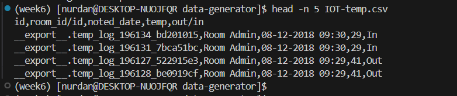
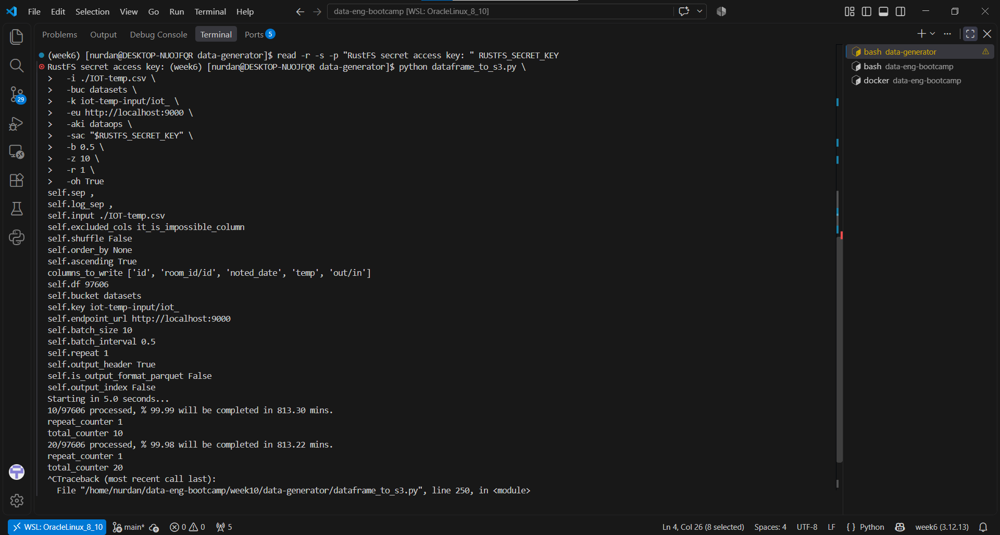
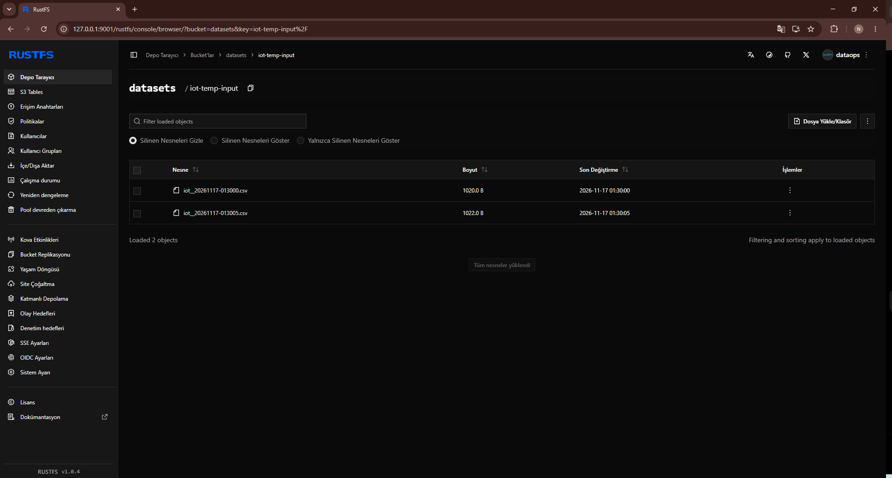
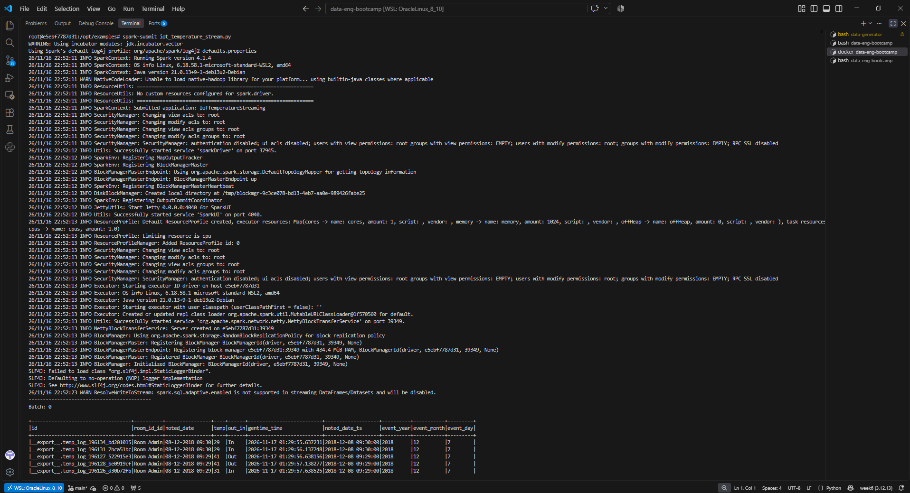
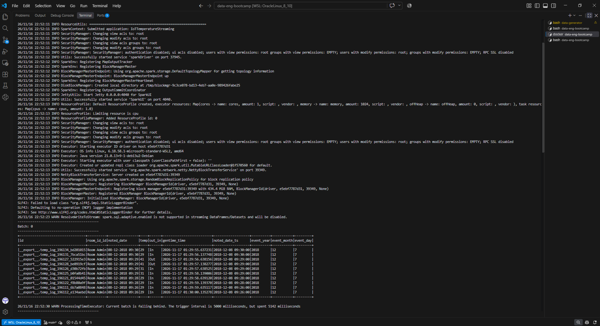
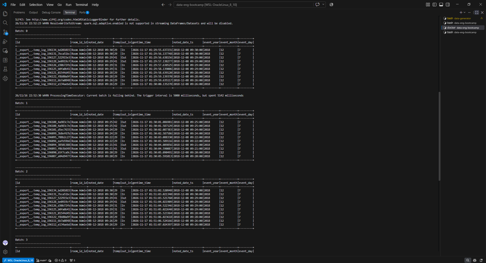

# Week 10 Homework — Spark Structured Streaming: IoT Temperature Data

## Objective

Build a Spark Structured Streaming application that continuously reads IoT temperature CSV files from an S3-compatible object store (RustFS), transforms the records using event-time information, and writes the results to a console sink.

The application demonstrates:

- File-based streaming ingestion from RustFS.
- Micro-batch processing with Spark Structured Streaming.
- Column name sanitization.
- Event-time parsing and derived date columns.
- Console sink output in append mode.
- Checkpointing for streaming progress and recovery.

## Environment

| Component | Technology |
|-----------|------------|
| Processing engine | Apache Spark 4.1.4 |
| Programming language | PySpark |
| Object storage | RustFS (S3-compatible) |
| Source format | CSV |
| Streaming source | `s3a://datasets/iot-temp-input/` |
| Streaming sink | Console |
| Output mode | Append |
| Processing trigger | 5 seconds |
| Checkpoint | `s3a://datasets/iot-temp-checkpoints/console` |

The application runs inside the `spark` container provided by the `00_spark_compose` environment.

---

## 1. Generate Streaming Data in RustFS

### 1.1. Dataset

The IoT temperature dataset was downloaded from:

https://github.com/erkansirin78/datasets/raw/master/IOT-temp.csv.zip

The archive was extracted to obtain `IOT-temp.csv`.

The source dataset contains the following columns:

```text
id,room_id/id,noted_date,temp,out/in
```

Example records:

```text
__export__.temp_log_196134_bd201015,Room Admin,08-12-2018 09:30,29,In
__export__.temp_log_196131_7bca51bc,Room Admin,08-12-2018 09:30,29,In
__export__.temp_log_196127_522915e3,Room Admin,08-12-2018 09:29,41,Out
```

The dataset contains 97,606 records.



### 1.2. Data-generator command

The data-generator was executed from the `week10/data-generator` directory.

The RustFS secret access key was entered through a terminal prompt to avoid including it directly in the generator command.

```bash
read -r -s -p "RustFS secret access key: " RUSTFS_SECRET_KEY

python dataframe_to_s3.py \
  -i ./IOT-temp.csv \
  -buc datasets \
  -k iot-temp-input/iot_ \
  -eu http://localhost:9000 \
  -aki dataops \
  -sac "$RUSTFS_SECRET_KEY" \
  -b 0.5 \
  -z 10 \
  -r 1 \
  -oh True
```

### Generator parameters

| Parameter | Description |
|-----------|-------------|
| `-i` | Input CSV file |
| `-buc` | Destination RustFS bucket |
| `-k` | Object key prefix |
| `-eu` | RustFS S3 API endpoint |
| `-aki` | RustFS access key |
| `-sac` | RustFS secret access key |
| `-b` | Delay between generated records |
| `-z` | Number of records per generated file |
| `-r` | Number of repetitions |
| `-oh` | Include CSV headers |

The generator writes small CSV files to:

```text
s3a://datasets/iot-temp-input/
```

For this demonstration, the generator was stopped manually after creating multiple files.

This was sufficient to test file-based streaming ingestion and observe multiple Spark micro-batches.



### 1.3. Verify generated files in RustFS

The generated files were verified through the RustFS web interface.

- RustFS Console: `http://localhost:9001`
- Bucket: `datasets`
- Directory: `iot-temp-input/`

The files follow a timestamp-based naming convention:

```text
iot_20261117-013000.csv
iot_20261117-013005.csv
```



---

## 2. Spark Structured Streaming Application

The application was implemented in:

```text
week10/homework/iot_temperature_stream.py
```

### 2.1. Application source code

The application contains the RustFS connection configuration directly inside `SparkSession.builder`.

**Security note:** The local application was tested with a hardcoded RustFS secret. The actual secret value is redacted below to avoid exposing credentials in the homework documentation.

```python
from pyspark.sql import SparkSession
from pyspark.sql import functions as F
from pyspark.sql.types import (
    StructType,
    StructField,
    StringType,
    IntegerType
)

# RustFS credentials
RUSTFS_ACCESS_KEY = "dataops"

# Redacted for repository documentation
RUSTFS_SECRET_KEY = "<REDACTED>"

# Spark session with S3A / RustFS configuration
spark = (
    SparkSession.builder
    .appName("IoTTemperatureStreaming")
    .config("spark.hadoop.fs.s3a.endpoint", "http://rustfs:9000")
    .config("spark.hadoop.fs.s3a.endpoint.region", "us-east-1")
    .config("spark.hadoop.fs.s3a.path.style.access", "true")
    .config("spark.hadoop.fs.s3a.connection.ssl.enabled", "false")
    .config(
        "spark.hadoop.fs.s3a.aws.credentials.provider",
        "org.apache.hadoop.fs.s3a.SimpleAWSCredentialsProvider"
    )
    .config("spark.hadoop.fs.s3a.access.key", RUSTFS_ACCESS_KEY)
    .config("spark.hadoop.fs.s3a.secret.key", RUSTFS_SECRET_KEY)
    .getOrCreate()
)

spark.sparkContext.setLogLevel("WARN")

# S3 paths
SOURCE_PATH = "s3a://datasets/iot-temp-input/"
CHECKPOINT_PATH = "s3a://datasets/iot-temp-checkpoints/console"

# Explicit schema
schema = StructType([
    StructField("id", StringType(), True),
    StructField("room_id/id", StringType(), True),
    StructField("noted_date", StringType(), True),
    StructField("temp", IntegerType(), True),
    StructField("out/in", StringType(), True),
    StructField("event_time", StringType(), True)
])

# 1. Read streaming CSV files
df = (
    spark.readStream
    .format("csv")
    .option("header", "true")
    .option("maxFilesPerTrigger", 1)
    .schema(schema)
    .load(SOURCE_PATH)
)

# 2. Transform data
df_transformed = (
    df
    .withColumnRenamed("room_id/id", "room_id_id")
    .withColumnRenamed("out/in", "out_in")
    .withColumnRenamed("event_time", "gentime_time")
    .withColumn(
        "noted_date_ts",
        F.to_timestamp(F.col("noted_date"), "dd-MM-yyyy HH:mm")
    )
    .withColumn("event_year", F.year("noted_date_ts"))
    .withColumn("event_month", F.month("noted_date_ts"))
    .withColumn("event_day", F.dayofweek("noted_date_ts"))
)

# 3. Select output columns
df_result = df_transformed.select(
    "id",
    "room_id_id",
    "noted_date",
    "temp",
    "out_in",
    "gentime_time",
    "noted_date_ts",
    "event_year",
    "event_month",
    "event_day"
)

# 4. Write to console sink
query = (
    df_result.writeStream
    .format("console")
    .outputMode("append")
    .trigger(processingTime="5 seconds")
    .option("numRows", 10)
    .option("truncate", False)
    .option("checkpointLocation", CHECKPOINT_PATH)
    .start()
)

query.awaitTermination()
```

### 2.2. Streaming source

The application reads CSV files using:

```python
spark.readStream.format("csv")
```

Unlike batch processing with `spark.read`, `spark.readStream` continuously monitors the source location for new files.

An explicit schema is provided because file-based Structured Streaming requires a predictable schema.

```python
.option("maxFilesPerTrigger", 1)
```

This setting limits the stream to processing at most one newly discovered file per micro-batch.

It makes it easier to observe separate batches during the demonstration.

### 2.3. Column transformations

The following column names are sanitized:

| Original column | Output column |
|-----------------|---------------|
| `room_id/id` | `room_id_id` |
| `out/in` | `out_in` |
| `event_time` | `gentime_time` |

The data-generator writes an ingestion-time column named `event_time`.

This column is renamed to `gentime_time` to match the expected homework output.

### 2.4. Event-time processing

The original `noted_date` column contains a timestamp represented as a string.

Example:

```text
08-12-2018 09:30
```

It is parsed using:

```python
F.to_timestamp(F.col("noted_date"), "dd-MM-yyyy HH:mm")
```

The result is stored in:

```text
noted_date_ts
```

Three additional columns are derived from this event timestamp:

```python
F.year("noted_date_ts")
F.month("noted_date_ts")
F.dayofweek("noted_date_ts")
```

For example:

| noted_date | noted_date_ts | event_year | event_month | event_day |
|------------|---------------|------------|-------------|-----------|
| 08-12-2018 09:30 | 2018-12-08 09:30:00 | 2018 | 12 | 7 |

Spark's `dayofweek()` function uses Sunday = 1 and Saturday = 7.

These values are calculated from the event timestamp rather than the time when Spark processes the record.

### 2.5. Console sink and checkpointing

The application writes processed records using:

```python
df_result.writeStream.format("console")
```

The output mode is:

```python
.outputMode("append")
```

Only newly processed rows are written to the console for each micro-batch.

The processing trigger is configured as:

```python
.trigger(processingTime="5 seconds")
```

The checkpoint location is:

```text
s3a://datasets/iot-temp-checkpoints/console
```

The checkpoint stores streaming progress information, including processed source offsets and commit metadata, allowing the application to recover its progress after a restart.

This application performs stateless transformations, so it does not require aggregation state.

---

## 3. Run the Streaming Application

### 3.1. Copy the application into the Spark container

From the project root directory:

```bash
cd ~/data-eng-bootcamp
```

Copy the application:

```bash
docker cp \
  week10/homework/iot_temperature_stream.py \
  spark:/opt/examples/iot_temperature_stream.py
```

Verify that the file exists inside the container:

```bash
docker exec spark \
  ls -l /opt/examples/iot_temperature_stream.py
```

### 3.2. Submit the application

The application was executed using:

```bash
docker exec -it spark /opt/spark/bin/spark-submit \
  /opt/examples/iot_temperature_stream.py
```

The S3A / RustFS connection settings are already configured within the Python application using `SparkSession.builder`.

Therefore, additional S3A configuration parameters are not required in the `spark-submit` command.

The application connects to:

```text
http://rustfs:9000
```

This is the RustFS endpoint accessible from inside the Docker network.



---

## 4. Streaming Output and Verification

### 4.1. First micro-batch

After starting the application, Spark discovers the CSV files in:

```text
s3a://datasets/iot-temp-input/
```

It reads the files as a streaming source and applies the defined transformations.

The console output includes the required columns:

```text
id
room_id_id
noted_date
temp
out_in
gentime_time
noted_date_ts
event_year
event_month
event_day
```

The first observed micro-batch confirms that the streaming application successfully reads and processes the generated IoT data.



### 4.2. Multiple micro-batches

The data-generator produces multiple CSV files under the same RustFS directory.

With:

```python
.option("maxFilesPerTrigger", 1)
```

Spark can process these files across separate micro-batches.

The console output confirms that the streaming application processes multiple batches rather than executing a single batch read.



### 4.3. Homework requirements checklist

- [x] Generate CSV files using the data-generator.
- [x] Write generated files to the RustFS `datasets` bucket.
- [x] Use the `iot-temp-input/` directory.
- [x] Read files using `spark.readStream`.
- [x] Use an explicit CSV schema.
- [x] Rename `room_id/id` to `room_id_id`.
- [x] Rename `out/in` to `out_in`.
- [x] Preserve the generator timestamp as `gentime_time`.
- [x] Parse `noted_date` into `noted_date_ts`.
- [x] Derive `event_year` from the event timestamp.
- [x] Derive `event_month` from the event timestamp.
- [x] Derive `event_day` from the event timestamp.
- [x] Write the results to the console sink.
- [x] Use append output mode.
- [x] Observe multiple streaming micro-batches.
- [x] Configure checkpointing for stream recovery.

---

## Conclusion

This homework demonstrates a file-based Spark Structured Streaming pipeline using RustFS as an S3-compatible source.

The data-generator continuously creates small CSV files, which Spark discovers and processes through micro-batches.

During processing, the application sanitizes column names, parses event timestamps, creates derived event-time columns, and preserves the ingestion timestamp.

The processed records are displayed through the console sink in append mode.

Checkpointing enables the streaming application to track its progress and recover after interruptions.

The exercise demonstrates how file arrivals in object storage can be processed incrementally using Spark Structured Streaming.