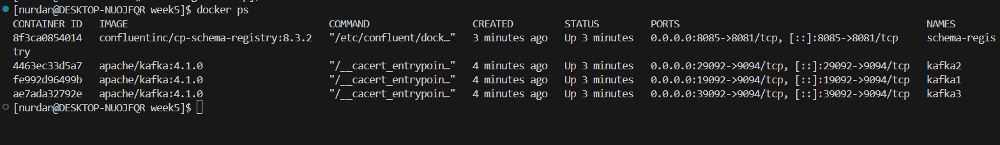
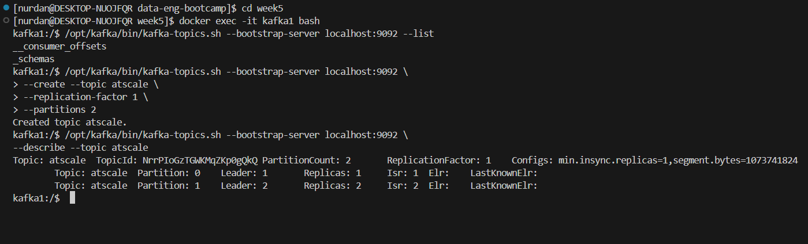
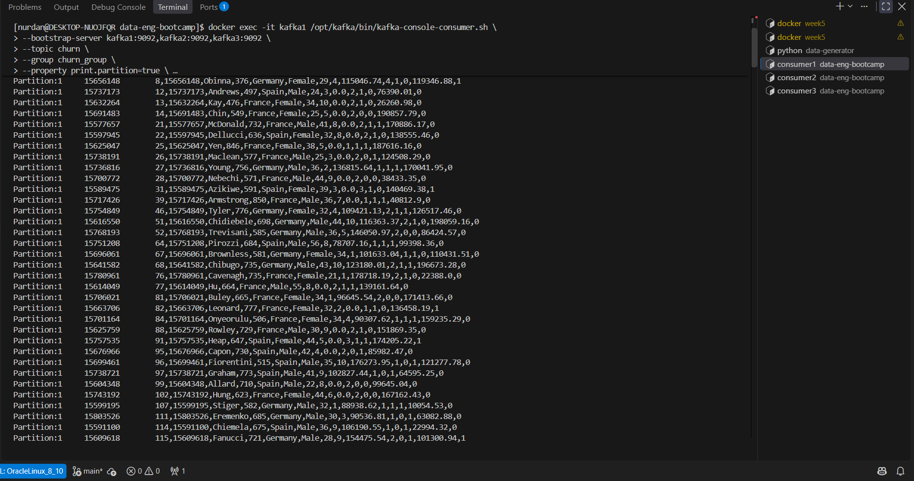
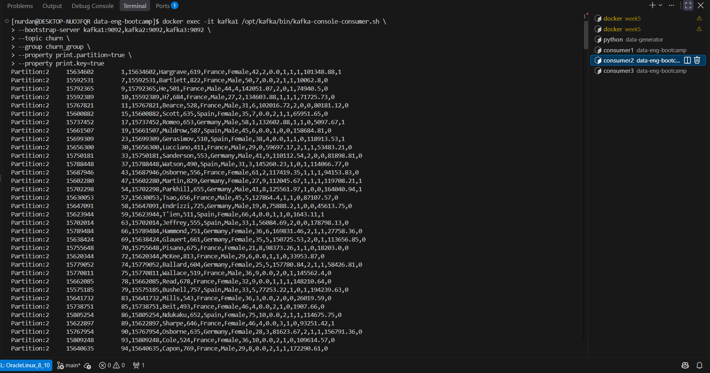
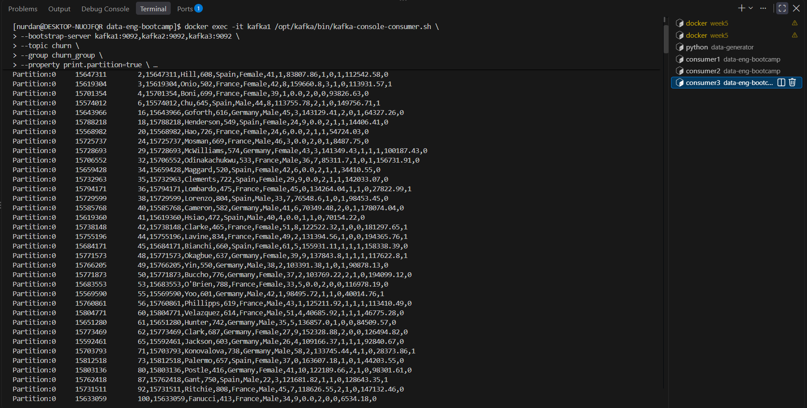
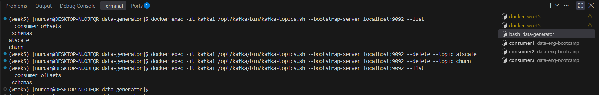

# Week 5 — Apache Kafka

## Overview

This assignment covers setting up a three-broker Apache Kafka cluster with Docker Compose, managing Kafka topics, streaming CSV data, and consuming messages with a consumer group.

## Project Structure

```text
week5/
├── data-generator/
├── screenShots/
│   ├── consumer1.png
│   ├── consumer2.png
│   ├── consumer3.png
│   ├── delete-topic.png
│   ├── describe-topic.png
│   └── init-kafka-cluster.png
├── docker-compose.yaml
└── README.md
```

## 1. Initialize the Kafka Cluster

A three-broker Kafka cluster was initialized using Docker Compose.



## 2. Create and Describe Topics

The `atscale` topic was created with **2 partitions** and a **replication factor of 1**.

The `churn` topic was configured with **3 partitions** and a **replication factor of 1**.

The topic description was used to inspect partition assignments and leader information.



## 3. Stream CSV Data to Kafka

The `Churn_Modelling.csv` dataset was published to the `churn` topic using the data generator.

**Dataset:** [Churn Modelling CSV](https://raw.githubusercontent.com/erkansirin78/datasets/master/Churn_Modelling.csv)

The message key was set to `CustomerId`. With a stable partition count and partitioning strategy, records with the same key are routed to the same partition.

## 4. Consume Messages with a Consumer Group

Messages from the `churn` topic were consumed using `kafka-console-consumer.sh`.

Three consumers were run in separate terminals using the same consumer group, `churn_group`. Since the topic has three partitions, the consumers can process assigned partitions in parallel.

### Consumer 1



### Consumer 2



### Consumer 3



## 5. Delete Topics

After completing the tasks, the `atscale` and `churn` topics were deleted.



## Key Learnings

- Initializing a multi-broker Kafka cluster with Docker Compose
- Creating, listing, and describing Kafka topics
- Understanding partitions, leaders, and replication factor
- Publishing CSV records to Kafka
- Using message keys for partition selection
- Consuming messages with consumer groups
- Running multiple consumers in parallel
- Deleting Kafka topics

## Technologies Used

- Apache Kafka
- Docker Compose
- Python
- `uv`
- Kafka command-line tools

## Conclusion

This assignment provided hands-on experience with Apache Kafka, from cluster initialization and topic management to streaming CSV data and consuming messages in parallel with a consumer group.
