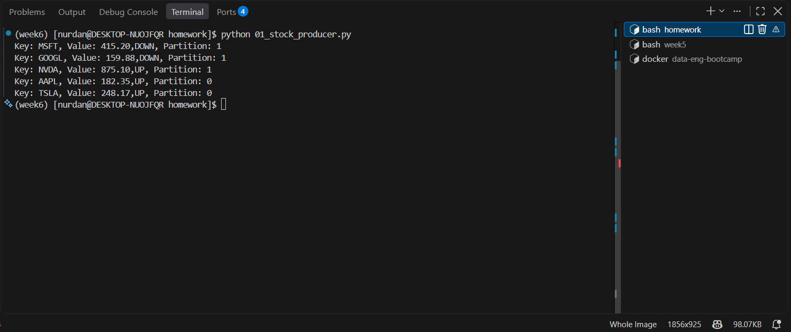
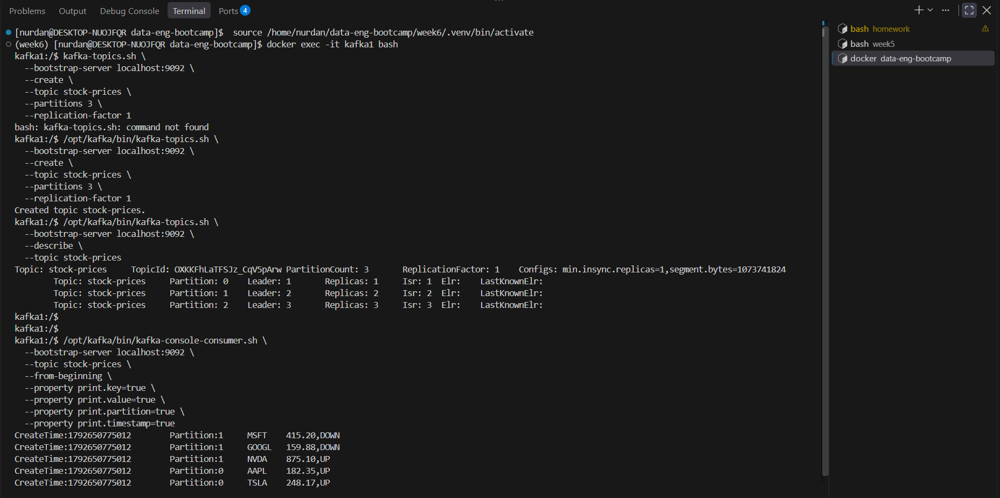
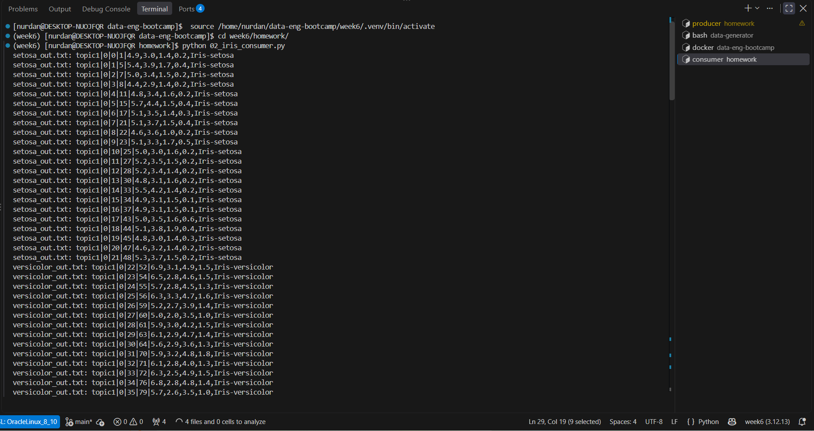
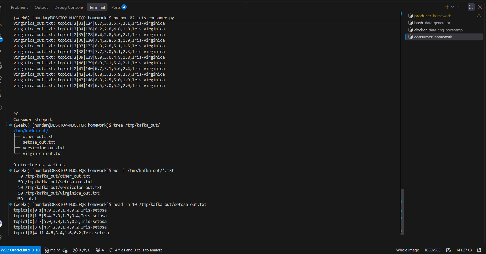
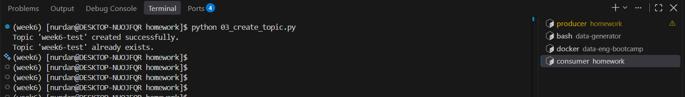
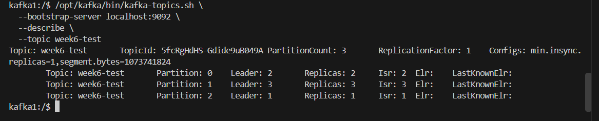

# Week 6 — Data Streaming & Event-Driven Architecture Homework

This homework practices Kafka message production and consumption, routing records to files, and topic administration with Python.

## Project Structure

```text
data-eng-bootcamp/
├── week5/
│   └── data-generator/          # Reused from Week 5 (not duplicated in Week 6)
└── week6/
    └── homework/
        ├── 01_stock_producer.py
        ├── 02_iris_consumer.py
        ├── 03_create_topic.py
        ├── config.py
        └── screenshots/
            ├── task1-producer.png
            ├── task1-consumer.png
            ├── irish-consumer.png
            ├── file-tree.png
            ├── create-topic-via-admin.png
            └── create-topic-via-admin-test.png
```

> **Data generator location:** The instructor's [`data-generator`](https://github.com/erkansirin78/data-generator) repository was already cloned under **`week5/data-generator/`** during Week 5. Task 2 reuses that existing copy; it is **not** downloaded or copied into `week6/homework/`.

## Task 1 — Stock Prices Producer & Consumer

`01_stock_producer.py` publishes five stock-price records to the `stock-prices` topic, using the ticker symbol as the **key** and `price,direction` as the **value**. Kafka selects the partition; delivery callbacks display the results.

```bash
python 01_stock_producer.py
```

Messages were verified using the Kafka **console consumer** with key, value, partition, and timestamp output, reading retained messages from the beginning of the topic.

**Producer output**



**Console consumer output**



## Task 2 — Iris CSV Streaming and File Routing

After clearing and recreating `topic1`, the `iris.csv` dataset was streamed into Kafka using the instructor's data generator from **`week5/data-generator/`**.

`02_iris_consumer.py` reads messages from `topic1` and routes each record to a separate file by species:

```text
/tmp/kafka_out/
├── other_out.txt
├── setosa_out.txt
├── versicolor_out.txt
└── virginica_out.txt
```

Each output line contains `topic|partition|offset|key|value`.

```bash
python 02_iris_consumer.py

tree /tmp/kafka_out/
wc -l /tmp/kafka_out/*.txt
head -n 10 /tmp/kafka_out/setosa_out.txt
```

**Verification:** 50 Setosa, 50 Versicolor, and 50 Virginica records (150 total); `other_out.txt` contained 0 records.

**Consumer routing output**



**Output files and record counts**



## Task 3 — Create Topic If It Does Not Exist

`03_create_topic.py` defines a function that accepts a `KafkaAdminClient`, topic name, partition count, and replication factor. It creates the topic only if a topic with that name is absent.

```bash
python 03_create_topic.py
```

The function was tested twice using `week6-test`: the first call created the topic, and the second detected that it already existed and took no action. Kafka CLI verification confirmed **3 partitions** and a **replication factor of 1**.

**Admin client output**



**Kafka topic verification**



## Notes

- Kafka broker connection settings are defined in `config.py`; update them for your environment.
- `kafka-python` is used for the admin-client task and `confluent-kafka` for producer/consumer tasks.
- `/tmp/kafka_out/` is a runtime output directory, not part of this repository.
