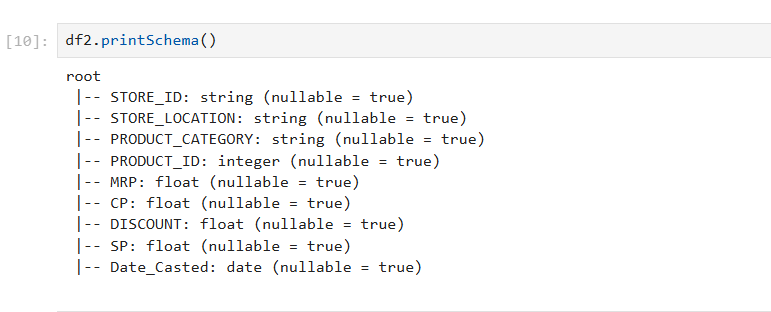
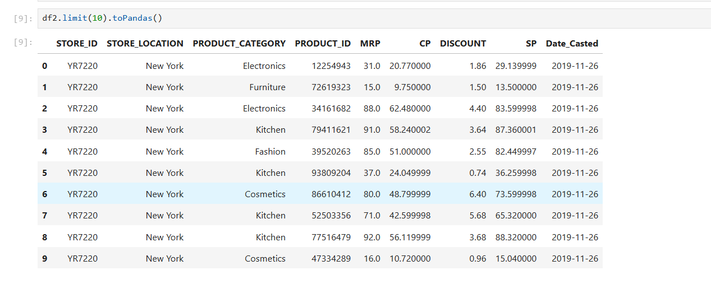
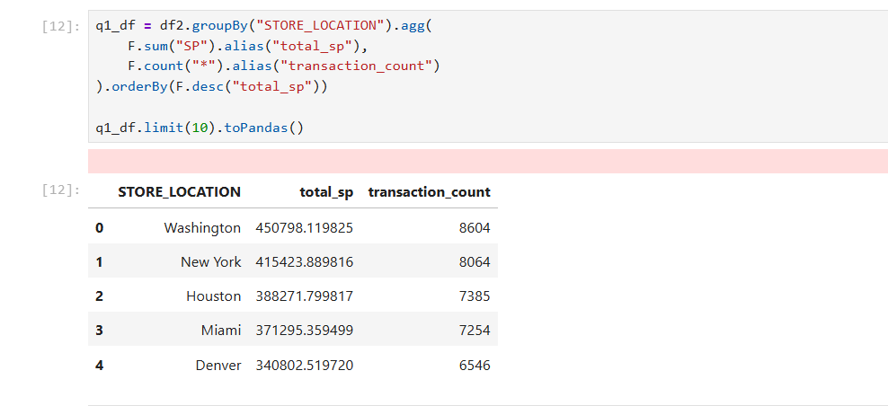
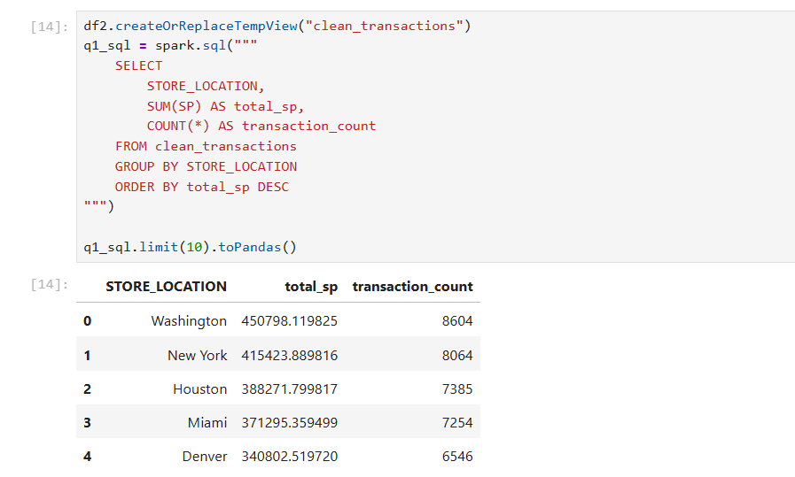
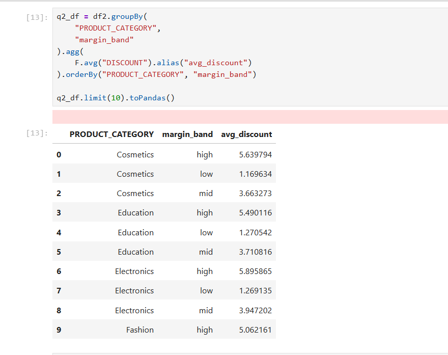
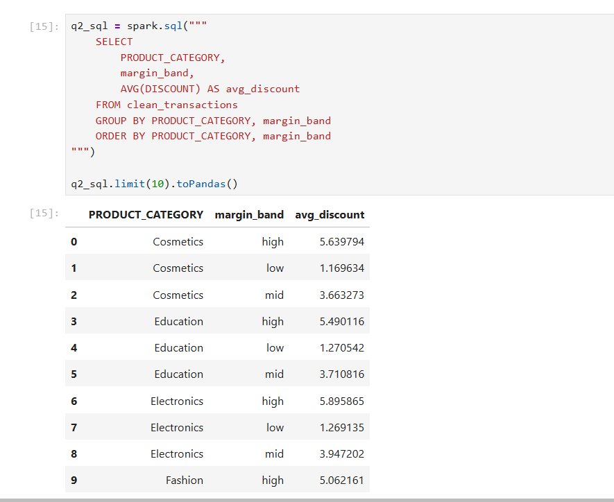
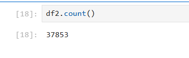
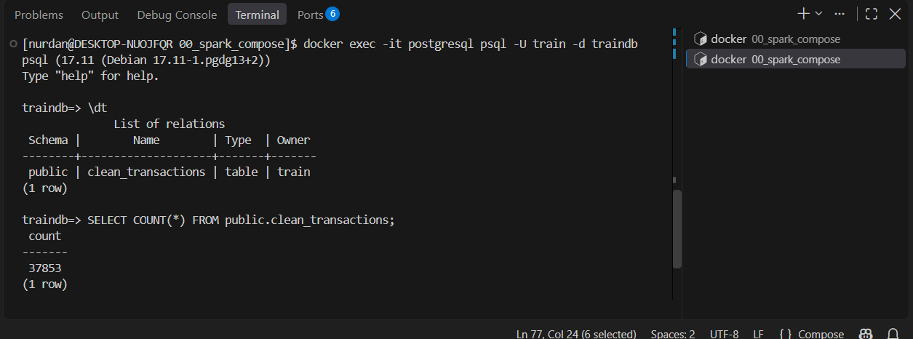

# Week 7 Homework — Cleaning Dirty Store Transactions with Spark DataFrames

**Data Engineering Bootcamp · Week 7 — Distributed Computation & Transformation**  
**Notebook:** [`clean_dirty_store_write2_psqlDb.ipynb`](./clean_dirty_store_write2_psqlDb.ipynb)  
**Dataset:** [dirty_store_transactions.csv](https://github.com/erkansirin78/datasets/raw/master/dirty_store_transactions.csv)  
**Technologies:** Apache Spark / PySpark, Spark SQL, Regex, JDBC, PostgreSQL, Docker, JupyterLab

## Objective

Build a batch ETL pipeline that reads a deliberately dirty store-transactions CSV, cleans and types its columns with PySpark, enriches it with a margin category, performs the same two analyses through the DataFrame API and Spark SQL, and writes the curated dataset to **`traindb.public.clean_transactions`**.

```text
Dirty CSV → Spark DataFrame → Cleaning + Casting → margin_band
                                       ├── DataFrame / Spark SQL analytics
                                       └── JDBC → PostgreSQL curated table
```

## 1. Full PySpark solution

The script below consolidates the cells from the submitted notebook into one runnable sequence. **The database password has been replaced with an environment variable for safe sharing.** The dataset is expected at `/opt/examples/datasets/dirty_store_transactions.csv`, as in the Docker playground. In the notebook, the CSV was downloaded with:

```bash
curl -o /opt/examples/datasets/dirty_store_transactions.csv \
  https://raw.githubusercontent.com/erkansirin78/datasets/master/dirty_store_transactions.csv
```

```python
# Week 7 Homework — Cleaning Dirty Store Transactions with Spark DataFrames
# Notebook: clean_dirty_store_write2_psqlDb.ipynb

import os
from pyspark.sql import SparkSession, functions as F

spark = (SparkSession.builder
    .appName("Cleaning Dirty Store Transactions with Spark DataFrames and PostgreSQL")
    .master("local[2]")
    .getOrCreate())

csv_path = "file:///opt/examples/datasets/dirty_store_transactions.csv"

# Task 1 — Infer the source schema
raw_df = (spark.read.format("csv")
    .option("sep", ",")
    .option("header", True)
    .option("inferSchema", True)
    .load(csv_path))
raw_df.printSchema()

# Task 2 — Clean dirty fields, then cast to target types
# Reason: invalid characters and currency prefixes would interfere with direct type inference/casting.
clean_df = raw_df.withColumn(
    "STORE_LOCATION",
    F.regexp_replace(F.col("STORE_LOCATION"), r"[^A-Za-z0-9]+$", "")
)
clean_df = clean_df.withColumn(
    "PRODUCT_ID",
    F.regexp_replace(F.col("PRODUCT_ID"), r"[^0-9]+$", "").cast("int")
)
for column in ["MRP", "CP", "DISCOUNT", "SP"]:
    clean_df = clean_df.withColumn(
        column,
        F.regexp_replace(F.col(column), r"^\$", "").cast("float")
    )
clean_df = (clean_df
    .withColumn("Date_Casted", F.to_date(F.col("Date"), "yyyy-MM-dd"))
    .drop("Date"))

clean_df.printSchema()
clean_df.limit(10).toPandas()

# Task 3 — Derived margin category
clean_df = clean_df.withColumn(
    "margin_band",
    F.when((F.col("MRP") - F.col("CP")) < 10, "low")
     .when(
         ((F.col("MRP") - F.col("CP")) >= 10) &
         ((F.col("MRP") - F.col("CP")) <= 30),
         "mid"
     )
     .otherwise("high")
)

# Task 4 — Q1 via DataFrame API
q1_df = (clean_df.groupBy("STORE_LOCATION")
    .agg(F.sum("SP").alias("total_sp"),
         F.count("*").alias("transaction_count"))
    .orderBy(F.desc("total_sp")))
q1_df.limit(10).toPandas()

# Task 4 — Q2 via DataFrame API
q2_df = (clean_df.groupBy("PRODUCT_CATEGORY", "margin_band")
    .agg(F.avg("DISCOUNT").alias("avg_discount"))
    .orderBy("PRODUCT_CATEGORY", "margin_band"))
q2_df.limit(10).toPandas()

# Task 4 — Spark SQL equivalents
clean_df.createOrReplaceTempView("clean_transactions")
q1_sql = spark.sql("""
    SELECT STORE_LOCATION,
           SUM(SP) AS total_sp,
           COUNT(*) AS transaction_count
    FROM clean_transactions
    GROUP BY STORE_LOCATION
    ORDER BY total_sp DESC
""")
q1_sql.limit(10).toPandas()

q2_sql = spark.sql("""
    SELECT PRODUCT_CATEGORY,
           margin_band,
           AVG(DISCOUNT) AS avg_discount
    FROM clean_transactions
    GROUP BY PRODUCT_CATEGORY, margin_band
    ORDER BY PRODUCT_CATEGORY, margin_band
""")
q2_sql.limit(10).toPandas()

# Task 5 — Write curated dataset to PostgreSQL via JDBC
# Define POSTGRES_PASSWORD in the Jupyter server/container environment first.
password = os.environ["POSTGRES_PASSWORD"]
(clean_df.write
    .format("jdbc")
    .mode("overwrite")
    .option("url", "jdbc:postgresql://postgresql:5432/traindb")
    .option("dbtable", "public.clean_transactions")
    .option("user", "train")
    .option("password", password)
    .option("driver", "org.postgresql.Driver")
    .save())

print("Spark record count:", clean_df.count())
```

**Chosen approach:** I cleaned and cast columns after reading the CSV because malformed identifiers and dollar-prefixed values cannot be reliably interpreted with the final numeric schema during ingestion.

**Regex rules:** `[^A-Za-z0-9]+$` removes trailing non-alphanumeric characters from locations; `[^0-9]+$` removes trailing non-digits from product IDs; `^\$` removes a leading dollar sign from money fields.

## 2. Schema outputs — inferred vs. cleaned

### 2.1 Inferred schema (Task 1)

Observed output of `raw_df.printSchema()` (`df.printSchema()` in the notebook):

```text
root
 |-- STORE_ID: string (nullable = true)
 |-- STORE_LOCATION: string (nullable = true)
 |-- PRODUCT_CATEGORY: string (nullable = true)
 |-- PRODUCT_ID: string (nullable = true)
 |-- MRP: string (nullable = true)
 |-- CP: string (nullable = true)
 |-- DISCOUNT: string (nullable = true)
 |-- SP: string (nullable = true)
 |-- Date: date (nullable = true)
```

The dirty ID and monetary fields are read as strings. The source `Date` column was inferred as `date` in this run.

### 2.2 Cleaned schema (Task 2)

Observed output of `clean_df.printSchema()` (`df2.printSchema()` in the notebook), **before** adding `margin_band`:

```text
root
 |-- STORE_ID: string (nullable = true)
 |-- STORE_LOCATION: string (nullable = true)
 |-- PRODUCT_CATEGORY: string (nullable = true)
 |-- PRODUCT_ID: integer (nullable = true)
 |-- MRP: float (nullable = true)
 |-- CP: float (nullable = true)
 |-- DISCOUNT: float (nullable = true)
 |-- SP: float (nullable = true)
 |-- Date_Casted: date (nullable = true)
```



The column names and types match the requested nine-column target schema. `margin_band` is added as a tenth column in Task 3.

## 3. First 10 cleaned rows

Actual output captured in the notebook **before** adding `margin_band`:

| # | STORE_ID | STORE_LOCATION | PRODUCT_CATEGORY | PRODUCT_ID | MRP | CP | DISCOUNT | SP | Date_Casted |
| --- | --- | --- | --- | --- | --- | --- | --- | --- | --- |
| 0 | YR7220 | New York | Electronics | 12254943 | 31.0 | 20.770000 | 1.86 | 29.139999 | 2019-11-26 |
| 1 | YR7220 | New York | Furniture | 72619323 | 15.0 | 9.750000 | 1.50 | 13.500000 | 2019-11-26 |
| 2 | YR7220 | New York | Electronics | 34161682 | 88.0 | 62.480000 | 4.40 | 83.599998 | 2019-11-26 |
| 3 | YR7220 | New York | Kitchen | 79411621 | 91.0 | 58.240002 | 3.64 | 87.360001 | 2019-11-26 |
| 4 | YR7220 | New York | Fashion | 39520263 | 85.0 | 51.000000 | 2.55 | 82.449997 | 2019-11-26 |
| 5 | YR7220 | New York | Kitchen | 93809204 | 37.0 | 24.049999 | 0.74 | 36.259998 | 2019-11-26 |
| 6 | YR7220 | New York | Cosmetics | 86610412 | 80.0 | 48.799999 | 6.40 | 73.599998 | 2019-11-26 |
| 7 | YR7220 | New York | Kitchen | 52503356 | 71.0 | 42.599998 | 5.68 | 65.320000 | 2019-11-26 |
| 8 | YR7220 | New York | Kitchen | 77516479 | 92.0 | 56.119999 | 3.68 | 88.320000 | 2019-11-26 |
| 9 | YR7220 | New York | Cosmetics | 47334289 | 16.0 | 10.720000 | 0.96 | 15.040000 | 2019-11-26 |



The `FloatType` values may show small floating-point representation artifacts, which is expected for binary floating-point values. `PRODUCT_ID` is integer, locations have the trailing special characters removed, and `Date_Casted` is a date.

## 4. Analytical queries — DataFrame API and Spark SQL

Both implementations use the same fully cleaned DataFrame **after** adding `margin_band`, which has these rules:

| Condition (`MRP - CP`) | `margin_band` |
| --- | --- |
| Less than 10 | `low` |
| Between 10 and 30 inclusive | `mid` |
| Greater than 30 | `high` |

### Q1 — Total selling price and transaction count by store location

**DataFrame API (`q1_df.limit(10).toPandas()`):**

| # | STORE_LOCATION | total_sp | transaction_count |
| --- | --- | --- | --- |
| 0 | Washington | 450798.119825 | 8604 |
| 1 | New York | 415423.889816 | 8064 |
| 2 | Houston | 388271.799817 | 7385 |
| 3 | Miami | 371295.359499 | 7254 |
| 4 | Denver | 340802.519720 | 6546 |



**Spark SQL (`q1_sql.limit(10).toPandas()`):**

| # | STORE_LOCATION | total_sp | transaction_count |
| --- | --- | --- | --- |
| 0 | Washington | 450798.119825 | 8604 |
| 1 | New York | 415423.889816 | 8064 |
| 2 | Houston | 388271.799817 | 7385 |
| 3 | Miami | 371295.359499 | 7254 |
| 4 | Denver | 340802.519720 | 6546 |



**Result:** The two approaches return the same five store locations with matching totals and transaction counts. Although the assignment requests the first 10 rows, this grouped result contains only **five rows**.

### Q2 — Average discount by product category and margin band

**DataFrame API (`q2_df.limit(10).toPandas()`):**

| # | PRODUCT_CATEGORY | margin_band | avg_discount |
| --- | --- | --- | --- |
| 0 | Cosmetics | high | 5.639794 |
| 1 | Cosmetics | low | 1.169634 |
| 2 | Cosmetics | mid | 3.663273 |
| 3 | Education | high | 5.490116 |
| 4 | Education | low | 1.270542 |
| 5 | Education | mid | 3.710816 |
| 6 | Electronics | high | 5.895865 |
| 7 | Electronics | low | 1.269135 |
| 8 | Electronics | mid | 3.947202 |
| 9 | Fashion | high | 5.062161 |



**Spark SQL (`q2_sql.limit(10).toPandas()`):**

| # | PRODUCT_CATEGORY | margin_band | avg_discount |
| --- | --- | --- | --- |
| 0 | Cosmetics | high | 5.639794 |
| 1 | Cosmetics | low | 1.169634 |
| 2 | Cosmetics | mid | 3.663273 |
| 3 | Education | high | 5.490116 |
| 4 | Education | low | 1.270542 |
| 5 | Education | mid | 3.710816 |
| 6 | Electronics | high | 5.895865 |
| 7 | Electronics | low | 1.269135 |
| 8 | Electronics | mid | 3.947202 |
| 9 | Fashion | high | 5.062161 |



**Result:** The DataFrame API and Spark SQL notebook outputs match for the displayed rows. Both are ordered by `PRODUCT_CATEGORY`, then `margin_band`, so their first 10 rows are comparable.

## 5. JDBC write to PostgreSQL — curated layer

**JDBC target:** `jdbc:postgresql://postgresql:5432/traindb`  
**Table:** `public.clean_transactions`  
**Write mode:** `overwrite`  
**JDBC driver:** `org.postgresql.Driver` (`postgresql-42.7.14.jar` was present in the Spark image).

The submitted notebook used a direct password value. For publishing, keep credentials outside the Git repository and supply `POSTGRES_PASSWORD` to the notebook runtime. Also note that `overwrite` replaces an existing target table, so use the correct database/table path.

### Record-count validation

The notebook's final Spark count was:



The PostgreSQL query, executed separately in `psql`, returned the same count:

```sql
SELECT COUNT(*) FROM public.clean_transactions;
```

```text
 count
-------
 37853
(1 row)
```



**Validation:** **37,853 Spark records = 37,853 PostgreSQL records.** Row-count parity confirms the volume written, but does not by itself prove every field is free of defects.

## 6. Debugging notes — malformed PRODUCT_ID values

An initial JDBC write failed because an ID such as `52503356^` could not be cast directly to `INT`. The initial pattern `[A-Za-z]+$` removed trailing letters only, not symbols like `^`. Updating the cleaning rule to **`[^0-9]+$`** removed trailing non-digits before the cast. The job was re-run and the JDBC write succeeded.

This also illustrates Spark's **lazy evaluation**: defining a DataFrame transformation does not validate every row; a full write can expose errors that were not present in an earlier 10-row preview.

## 7. Deliverables and evidence

```text
week7/
└── homework/
    ├── 01_dirty_data_clean_solution.md
    ├── clean_dirty_store_write2_psqlDb.ipynb
    └── screenShots/
        ├── clean-schema.png
        ├── first-10-rows-of-clean-data.png
        ├── q1-df.png
        ├── q1-sql.png
        ├── q2-df.png
        ├── q2-sql.png
        └── count-rows-db-after-write-posgreSqlDb.png
```

All image paths above are **relative to this Markdown file**. Keep the capitalization of `screenShots` and screenshot filenames unchanged on Linux/GitHub.

## 8. Key takeaways

- A custom target schema cannot fix dirty strings by itself; **clean first, then cast**.
- `withColumn`, `regexp_replace`, `cast` and `to_date` provide explicit transformation steps.
- `F.when(...).otherwise(...)` creates a derived categorical column without SQL `CASE WHEN`.
- PySpark DataFrame and Spark SQL queries can express the same aggregations.
- Writing through JDBC materializes the Spark plan and makes data-quality problems visible across the dataset.
- The curated PostgreSQL table was checked against the Spark row count: **37,853 records**.

**Source notebook:** [`clean_dirty_store_write2_psqlDb.ipynb`](./clean_dirty_store_write2_psqlDb.ipynb).
