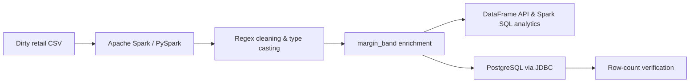

# Week 7 — Distributed Computation & Data Transformation with Apache Spark

**Data Engineering Bootcamp | Week 7 Homework**  
**Project:** Cleaning Dirty Store Transactions with Spark DataFrames  
**Result:** **37,853 rows** written to PostgreSQL and verified against the cleaned Spark DataFrame.

## Overview

This assignment implements a small **batch ETL pipeline**: ingest a deliberately dirty retail CSV, clean and type its columns with **PySpark DataFrame transformations**, analyze the curated data with **both the DataFrame API and Spark SQL**, and write the result to **PostgreSQL via JDBC**.

The focus is on practical distributed data processing: explicit type conversion, regular expressions, lazy evaluation, aggregations, and validation before and after database ingestion.

## Data pipeline



### Technology stack

| Technology | Role |
|---|---|
| Python / PySpark | Batch ingestion, data cleaning, transformations, and analytics |
| Apache Spark 4.x | Distributed computation and Spark SQL |
| PostgreSQL 17 | Curated relational data layer |
| JDBC (PostgreSQL driver) | Spark-to-PostgreSQL integration |
| Docker Compose + WSL | Reproducible local service environment |
| JupyterLab | Interactive development and output review |

> The broader Docker Compose playground also includes Kafka, RustFS, and Apache Polaris. **This homework's required processing path uses Spark and PostgreSQL**; the other services are not required for the CSV-to-PostgreSQL flow.

## Repository layout

```text
week7/
├── README.md                         # This document
└── 00_spark_compose/
    ├── docker-compose.yaml           # Local data-engineering environment
    ├── image/
    │   └── Dockerfile
    └── spark/
        └── examples/
            ├── datasets/
            │   └── dirty_store_transactions.csv
            └── homework/
                └── clean_dirty_store_write2_psqlDb.ipynb
```

> Keep the required `01_dirty_data_clean_solution.md` submission alongside the notebook when you export the final code and outputs. Generated `.ipynb_checkpoints/` folders should not be committed.

**Notebook:** [Week 7 homework](./00_spark_compose/spark/examples/homework/clean_dirty_store_write2_psqlDb.ipynb)  
**Dataset:** [dirty_store_transactions.csv](https://github.com/erkansirin78/datasets/raw/master/dirty_store_transactions.csv)

## Dataset and data-quality issues

The source contains retail transactions with nine input columns:

`STORE_ID`, `STORE_LOCATION`, `PRODUCT_CATEGORY`, `PRODUCT_ID`, `MRP`, `CP`, `DISCOUNT`, `SP`, `Date`.

| Column | Example of dirty input | Transformation | Output type |
|---|---|---|---|
| `STORE_ID` | `YR7220` | Preserve | `string` |
| `STORE_LOCATION` | `New York(`, `New York+` | Remove trailing non-alphanumeric characters | `string` |
| `PRODUCT_CATEGORY` | `Electronics` | Preserve | `string` |
| `PRODUCT_ID` | `72619323C`, `52503356^` | Remove trailing non-digit characters, then cast | `integer` |
| `MRP`, `CP`, `DISCOUNT`, `SP` | `$31`, `$20.77` | Remove leading `$`, then cast | `float` |
| `Date` | `2019-11-26` | Parse to `Date_Casted`; drop original | `date` |

### Ingestion and schema strategy

1. Read the raw CSV using `inferSchema=True` and inspect `printSchema()`.
2. Preserve the original dirty values and apply **`withColumn()` + `regexp_replace()` + `cast()`** after ingestion.
3. Display the final `printSchema()` and preview the first 10 rows.

**Why this approach?** Dirty currency symbols and trailing characters make direct casting to the target numeric types unreliable; cleaning the raw text before casting avoids malformed-input errors and unintended null values.

### Key cleaning expressions

```python
from pyspark.sql import functions as F

# Keep spaces inside city names, but remove trailing punctuation/whitespace.
F.regexp_replace(F.col("STORE_LOCATION"), r"[^A-Za-z0-9]+$", "")

# Handle both a trailing letter (72619323C) and punctuation (52503356^).
F.regexp_replace(F.col("PRODUCT_ID"), r"[^0-9]+$", "").cast("int")

# Remove a leading dollar sign before conversion.
F.regexp_replace(F.col("MRP"), r"^\$", "").cast("float")

# Convert the date string to a date column.
F.to_date(F.col("Date"), "yyyy-MM-dd")
```

The same monetary transformation is applied to `CP`, `DISCOUNT`, and `SP`. After cleaning, the original `Date` column is removed and the typed column is named `Date_Casted`.

**Target schema before enrichment:**

```text
root
 |-- STORE_ID: string
 |-- STORE_LOCATION: string
 |-- PRODUCT_CATEGORY: string
 |-- PRODUCT_ID: integer
 |-- MRP: float
 |-- CP: float
 |-- DISCOUNT: float
 |-- SP: float
 |-- Date_Casted: date
```

## Derived feature: `margin_band`

A new column classifies the difference `MRP - CP` into three groups:

| Margin | Band |
|---|---|
| `< 10` | `low` |
| `10–30` (inclusive) | `mid` |
| `> 30` | `high` |

```python
margin = F.col("MRP") - F.col("CP")

df2 = df2.withColumn(
    "margin_band",
    F.when(margin < 10, "low")
     .when(margin <= 30, "mid")
     .otherwise("high")
)
```

> This follows the homework's three-band rule for valid numeric rows. In a production pipeline, missing MRP/CP values should be assessed explicitly instead of implicitly falling into `high`.

## Analytical queries: DataFrame API vs. Spark SQL

Two questions were implemented **twice**, once with each API, and the first 10 results were displayed.

### Q1 — Sales and transaction counts by store location

```python
# DataFrame API
q1_df = (
    df2.groupBy("STORE_LOCATION")
       .agg(
           F.sum("SP").alias("total_sp"),
           F.count("*").alias("transaction_count")
       )
       .orderBy(F.desc("total_sp"))
)
q1_df.show(10, truncate=False)
```

```python
# Spark SQL
# Register the cleaned DataFrame once for both SQL queries.
df2.createOrReplaceTempView("clean_transactions")

q1_sql = spark.sql("""
    SELECT STORE_LOCATION,
           SUM(SP) AS total_sp,
           COUNT(*) AS transaction_count
    FROM clean_transactions
    GROUP BY STORE_LOCATION
    ORDER BY total_sp DESC
""")
q1_sql.show(10, truncate=False)
```

### Q2 — Average discount by category and margin band

```python
# DataFrame API
q2_df = (
    df2.groupBy("PRODUCT_CATEGORY", "margin_band")
       .agg(F.avg("DISCOUNT").alias("avg_discount"))
       .orderBy("PRODUCT_CATEGORY", "margin_band")
)
q2_df.show(10, truncate=False)
```

```python
# Spark SQL
q2_sql = spark.sql("""
    SELECT PRODUCT_CATEGORY,
           margin_band,
           AVG(DISCOUNT) AS avg_discount
    FROM clean_transactions
    GROUP BY PRODUCT_CATEGORY, margin_band
    ORDER BY PRODUCT_CATEGORY, margin_band
""")
q2_sql.show(10, truncate=False)
```

Both interfaces use Spark's distributed SQL execution engine. Consistent output column ordering and `ORDER BY` clauses make the results easier to compare.

## PostgreSQL: curated data layer

The cleaned, enriched DataFrame was written to:

```text
Database: traindb
Schema:   public
Table:    clean_transactions
```

Spark communicates with PostgreSQL through its JDBC connector and the PostgreSQL JDBC driver. The service hostname `postgresql` is resolvable from the Spark container on the Docker Compose network.

**Example write configuration** (provide the password securely to the Jupyter kernel; never commit credentials):

```python
import os

jdbc_url = "jdbc:postgresql://postgresql:5432/traindb"
password = os.environ["DB_PASSWORD"]

(
    df2.write
       .format("jdbc")
       .mode("overwrite")
       .option("url", jdbc_url)
       .option("dbtable", "public.clean_transactions")
       .option("user", "train")
       .option("password", password)
       .option("driver", "org.postgresql.Driver")
       .save()
)
```

> `overwrite` replaces the destination table/data and should be used carefully. A failed JDBC write can leave an incomplete destination; always validate after a successful rerun.

### Verified result

| Check | Count |
|---|---:|
| Cleaned Spark DataFrame | **37,853** |
| PostgreSQL `public.clean_transactions` | **37,853** |
| Row-count consistency | **PASS** |

PostgreSQL verification:

```sql
SELECT COUNT(*) FROM public.clean_transactions;
-- 37853
```

Row-count equality verifies the loaded record volume; it does **not** by itself prove every transformed value is correct.

## Running locally

From the `00_spark_compose` directory:

```bash
# Start the services needed for this homework.
docker compose up -d spark postgresql

# Check container status.
docker compose ps

# Open JupyterLab inside the running Spark container.
docker exec -it spark jupyter lab --ip 0.0.0.0 --port 8888 --allow-root
```

Open the JupyterLab URL printed in the terminal (normally accessible via `http://127.0.0.1:8888`), then open:

```text
/opt/examples/homework/clean_dirty_store_write2_psqlDb.ipynb
```

Ensure the PostgreSQL `traindb` database, `train` user, and required schema permissions exist before JDBC writing. The PostgreSQL driver JAR must also be available to Spark. For the database configuration steps, see the course's JDBC/PostgreSQL example notebook.

After successful execution, verify the database from WSL:

```bash
docker exec -it postgresql psql -U postgres -d traindb \
  -c 'SELECT COUNT(*) FROM public.clean_transactions;'
```

**Notebook persistence:** Docker binds `./spark/examples` to `/opt/examples`, so saved notebooks are available in the repository folder on the host as well.

## Debugging and lessons learned

The first JDBC write failed with a Spark error:

```text
[CAST_INVALID_INPUT]
The value '52503356^' cannot be cast from STRING to INT.
```

An initial `PRODUCT_ID` regex removed only trailing letters (`[A-Za-z]+$`). The dataset also contained other trailing characters, including `^`. Updating the expression to **`[^0-9]+$`** removed non-digit suffixes before casting. The pipeline was rerun and the **37,853-row** database count was verified.

This demonstrates an important behavior of **Spark lazy evaluation**: a transformation may appear valid when defined or previewed on a small sample but fail only when an action processes the full dataset, such as a JDBC write.

Key takeaways:

- Clean raw string values **before** assigning numeric types.
- Use Spark DataFrame and SQL APIs interchangeably for equivalent aggregations.
- Inspect both the inferred and target schemas.
- Do not rely only on `limit(10)` previews to validate an entire dataset.
- Verify loaded rows in the destination system after a JDBC write.
- Never commit database passwords, tokens, or other secrets.

## Submission checklist

- [x] Ingest source CSV and inspect inferred schema
- [x] Clean and type transaction columns
- [x] Derive `margin_band`
- [x] Implement Q1 and Q2 using DataFrame API and Spark SQL
- [x] Write the curated DataFrame to PostgreSQL via JDBC
- [x] Verify matching row counts (**37,853**)
- [ ] Export the required `01_dirty_data_clean_solution.md` with complete code, both schema outputs, the first 10 cleaned rows, and all four query result previews
- [ ] Attach/submit the final `.ipynb` notebook alongside the Markdown deliverable

## References

- [PySpark DataFrame API](https://spark.apache.org/docs/latest/api/python/reference/pyspark.sql/dataframe.html)
- [PySpark `regexp_replace`](https://spark.apache.org/docs/latest/api/python/reference/pyspark.sql/api/pyspark.sql.functions.regexp_replace.html)
- [PySpark JDBC data source](https://spark.apache.org/docs/latest/sql-data-sources-jdbc.html)
- [Apache Spark documentation](https://spark.apache.org/docs/latest/)

---

*Veri Bilimi Okulu — Data Engineering Bootcamp, Week 7.*
