# Week 9 — Apache Spark Deployment: Standalone, Spark Connect & Kubernetes

**Data Engineering Bootcamp — Week 9**  
**Instructor:** Erkan Şirin  
**Topics:** Spark Standalone · Spark Connect · Docker Compose · Kubernetes · Spark Operator · Helm · OpenShift

## Overview

This week focused on how an Apache Spark application moves from a development environment to a distributed cluster, how Spark components communicate, and how to deploy or manage Spark jobs using different infrastructure and submission methods.

The practical work covered:

- **Spark Standalone** with Docker Compose, including Master, Worker, Driver and Executor roles.
- **Horizontal scaling** of Spark Workers with `docker compose --scale`.
- **Batch submissions** using `spark-submit` and S3-compatible storage through RustFS.
- **Spark Connect**, where a thin Python client communicates with a server-side Driver via gRPC.
- **Spark on Kubernetes** in both client and cluster deploy modes.
- **Kubeflow Spark Operator**, installed using Helm and driven by `SparkApplication` resources.
- **OpenShift** as a Kubernetes-based application platform, including Projects, BuildConfig, ImageStream and in-cluster Spark submission.
- **Week 9 homework:** Run a PySpark application on Docker Desktop Kubernetes and capture its Driver/Executor lifecycle.

## Project Structure

```text
week9/
├── 03_standalone/
│   ├── docker-compose.yaml
│   ├── README.md
│   └── spark_client/examples/
│       ├── simple_submit.py
│       ├── spark_connect_example.py
│       ├── 01_spark_eda_jupyterlab_virtualenv_setup.txt
│       └── notebooks/spark_rustfs_example.ipynb
├── 04_kubernetes/
│   ├── 01_spark_on_k8s_spark-submit.md
│   ├── 02_spark_on_k8s_operator_helm.md
│   ├── 04_spark_on_openshift.md
│   ├── 05_spark_on_openshift_wsl.md
│   ├── 06_spark_operator_on_openshift_wsl.md
│   └── spark_on_k8s/                 # Live Kubernetes examples
│       ├── Dockerfile
│       ├── spark_on_k8s_app.py
│       └── k8s-spark-app-obj.yaml
├── homework/
│   ├── Dockerfile
│   ├── spark_on_k8s_hw.py
│   ├── spark_on_k8s_hw_solution.md
│   └── screenShots/
│       ├── 01-cluster-ready.png
│       ├── 02-serviceaccount-rbac.png
│       ├── 03-driver-executors-running.png
│       ├── 04-driver-log-50-rows.png
│       ├── 05-driver-log-beginning.png
│       ├── 06-driver-completed.png
│       └── 07-spark-submit-running.png
├── screenShots/                      # Live lesson screenshots
└── README.md
```

> The layout above summarizes the lesson resources and the current homework arrangement. OpenShift live-example files are also provided in the lesson materials under `spark_on_openshift/`. Some reference documents and examples may be organized differently in the local repository.

## 1. Spark Standalone Cluster with Docker Compose

In **Spark Standalone**, the **Master** manages cluster resources, **Workers** host Executor processes, the **Driver** coordinates the application, and **Executors** run distributed tasks.

| Component | Responsibility |
|---|---|
| Master | Tracks Workers and coordinates resource allocation |
| Worker | Provides resources and launches Executor processes |
| Driver | Runs the application's control logic and schedules tasks |
| Executor | Executes tasks and processes data partitions |

### Start and scale the cluster

From `week9/03_standalone/`:

```bash
docker compose up -d --scale spark-worker=3
docker compose ps
```

The three Workers are three **containers created from one Worker image**, not three physical machines. The scalable `spark-worker` service must **not** have a fixed `container_name`; Docker Compose creates names such as `03_standalone-spark-worker-1`, `-2` and `-3`.

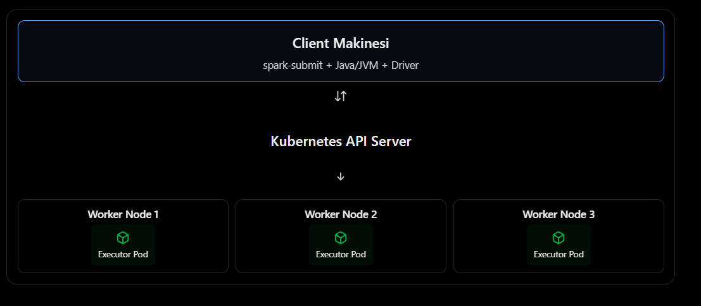

**Useful interfaces:**

| Service | Address / purpose |
|---|---|
| Spark Master UI | `http://localhost:8080/` |
| Spark Worker UIs | Host ports in the `8081–8089` range, as assigned by Compose |
| Classic Spark Driver UI | `http://localhost:4041/`, while a Driver is running in `spark-client` |
| Spark Connect Driver UI | `http://localhost:4042/`, while available |
| Spark Connect gRPC | `localhost:15002` — not a browser UI |
| RustFS Console | `http://localhost:9001/` |

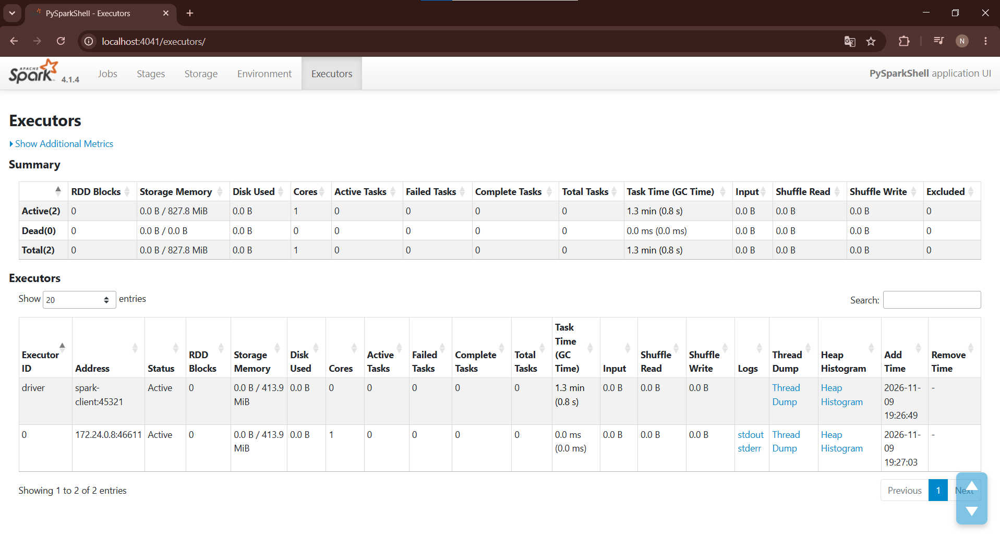

### Run a PySpark job with `spark-submit`

The lesson used an S3-compatible **RustFS** bucket and a sample Iris CSV file. The Hadoop S3A connector was supplied using `--packages` because it was not bundled in the base Spark image.

```bash
docker exec spark-client /opt/spark/bin/spark-submit \
  --master spark://spark-master:7077 \
  --conf spark.driver.host=spark-client \
  --conf spark.jars.ivy=/tmp/.ivy2 \
  --packages org.apache.hadoop:hadoop-aws:3.4.2 \
  /opt/examples/simple_submit.py
```

Here the Driver runs in `spark-client` (**client deploy mode**), while the Spark Workers provide Executors. The S3A dependency must be compatible with the Hadoop version bundled with the Spark image. Any RustFS endpoint and credentials must be configured appropriately for the environment; do **not** commit real access credentials to source control.

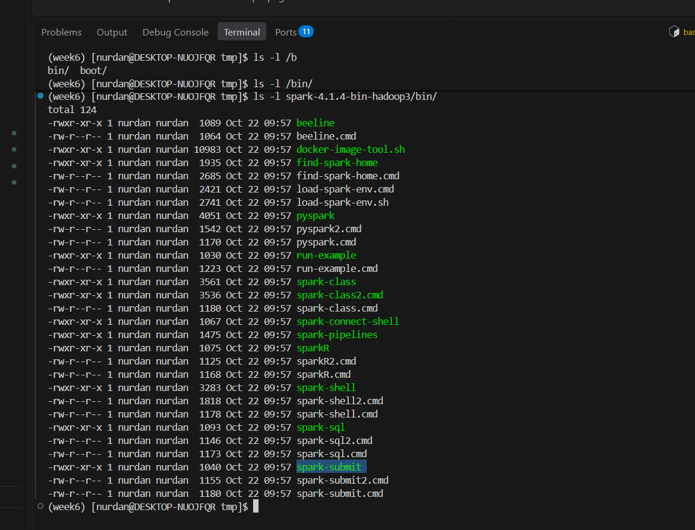

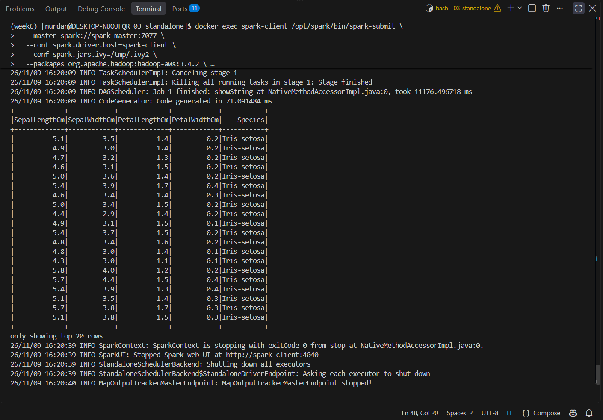

For further environment details, see [03_standalone/README.md](03_standalone/README.md).

## 2. Spark Connect — Thin Client Architecture

With classic PySpark, the Driver requires local Spark/JVM components in the environment where it runs. **Spark Connect** separates the Python client from the long-running server-side Driver:

```text
Python thin client
      |
      | gRPC (:15002)
      v
Spark Connect Server + Driver
      |
      v
Spark Standalone Master → Worker Executors
```

In the provided Compose setup, the `spark-connect` service starts the Connect server. A client can use a Python virtual environment and install only the Connect client package:

```bash
python3 -m venv .venv
source .venv/bin/activate
pip install 'pyspark-client==4.1.4'
```

Example Python connection:

```python
from pyspark.sql import SparkSession

spark = SparkSession.builder.remote("sc://spark-connect:15002").getOrCreate()
spark.range(10).show()
```

**Key differences:** The client talks gRPC, does not need its own JVM or Spark JAR distribution, and cannot use classic `SparkContext`/RDD APIs via the Connect client. Spark and Java still run on the **server side**. Use compatible client/server versions; version `4.1.4` was used in this lesson.

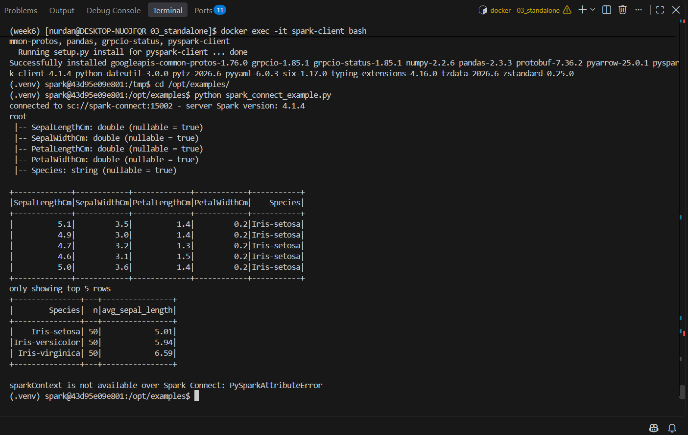

> **Virtual environment vs persistence:** A Python `venv` isolates packages but does not make them persistent on its own. A `venv` under `/tmp` in a container can disappear when the container is recreated; use a Docker volume or bake dependencies into an image for repeatable environments.

## 3. Spark on Kubernetes

Kubernetes replaces the Spark Standalone Master/Worker resource-management layer with the **Kubernetes API Server, scheduler and Nodes**. Spark Drivers and Executors can run as Pods.

### Client mode vs cluster mode

| | Client mode | Cluster mode |
|---|---|---|
| Driver location | Submission environment (WSL in the lesson) | Kubernetes Driver Pod |
| Executor location | Kubernetes Pods | Kubernetes Pods |
| Local classic `spark-submit` | Java and Spark binary required | Java and Spark binary required for the submitting process |
| Client needed for Driver lifetime | Yes | No, after the cluster accepts the submission |
| Networking | Executors must reach external Driver | Driver and Executors communicate in-cluster |

### Client-mode troubleshooting: WSL2 network access

We first ran `spark-submit` on WSL2 with a Driver advertised at a WSL2 IP. The Kubernetes Executor Pods started but could not connect to `172.20.119.128:7078` and timed out. This was **not** a Kubernetes API authentication problem: the Pods were created successfully.

`kubectl proxy --port=8001` provided a local HTTP entry point for **submission to the Kubernetes API**; it did not forward Driver-to-Executor traffic. The working lesson setup instead advertised the Driver with a hostname reachable from Kubernetes:

```bash
--conf spark.driver.host=host.docker.internal \
--conf spark.driver.bindAddress=0.0.0.0 \
--conf spark.driver.port=7078 \
--conf spark.driver.blockManager.port=7079
```

The working configuration was verified by completed Spark jobs and DataFrame output.

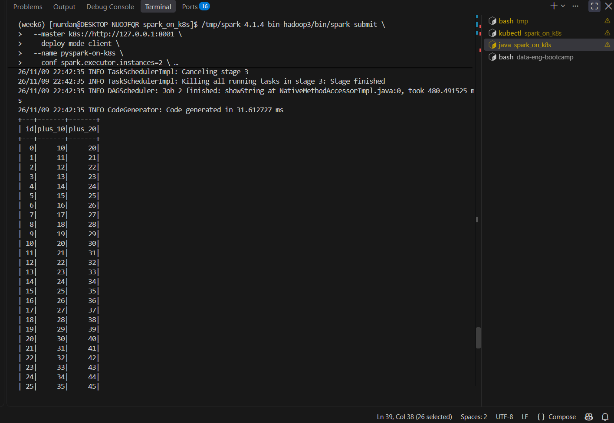

### Cluster mode

For cluster deployment, `spark-submit` asks Kubernetes to create the **Driver Pod**. The Driver then requests Executor Pods using its Kubernetes ServiceAccount permissions. The application must be accessible inside the Driver image, typically with a path such as:

```text
local:///opt/spark/work-dir/app/spark_on_k8s_app.py
```

This `local:///` path refers to the **container filesystem**, not to a WSL directory. Cluster mode also avoids the external WSL-to-Driver networking issue observed in client mode.

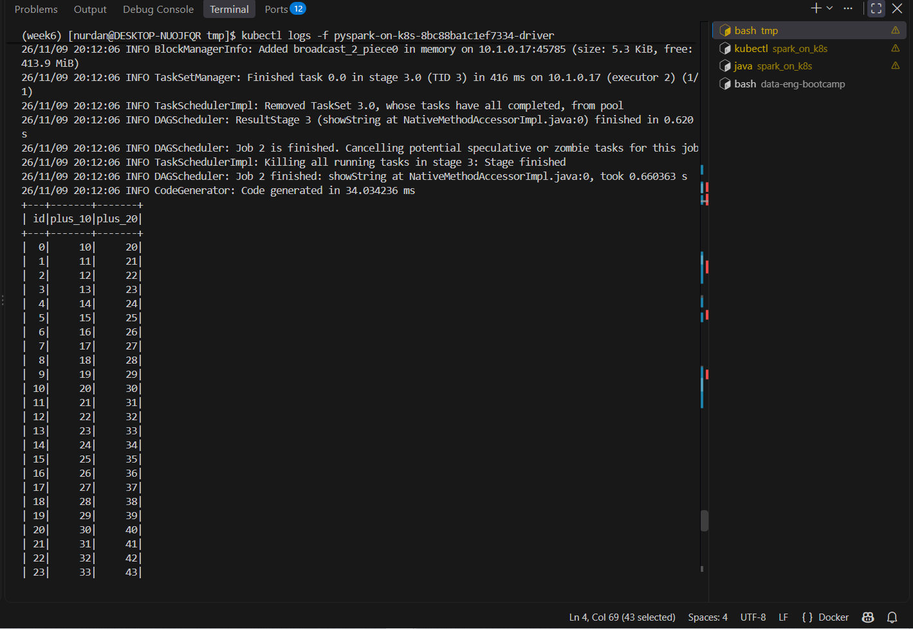

## 4. Spark Operator and Helm

A Kubernetes **Operator** extends the API with application-specific reconciliation logic. In our lesson we used **Kubeflow Spark Operator**, installed with a **Helm Chart**. Helm manages the Operator installation; the running Operator watches `SparkApplication` custom resources and manages application submissions and their lifecycle.

```bash
helm repo add spark-operator https://kubeflow.github.io/spark-operator
helm repo update

helm install my-spark-operator-release spark-operator/spark-operator \
  --namespace spark-operator \
  --create-namespace \
  --set webhook.enable=true
```

Typical workflow:

```bash
kubectl get pods -n spark-operator
kubectl apply -f k8s-spark-app-obj.yaml
kubectl get sparkapplications
kubectl get pods -w
```

The admission webhook must be ready before a `SparkApplication` is accepted. During the live exercise, an initial `connect: connection refused` error to the webhook service was resolved by retrying after the Operator and webhook became available.

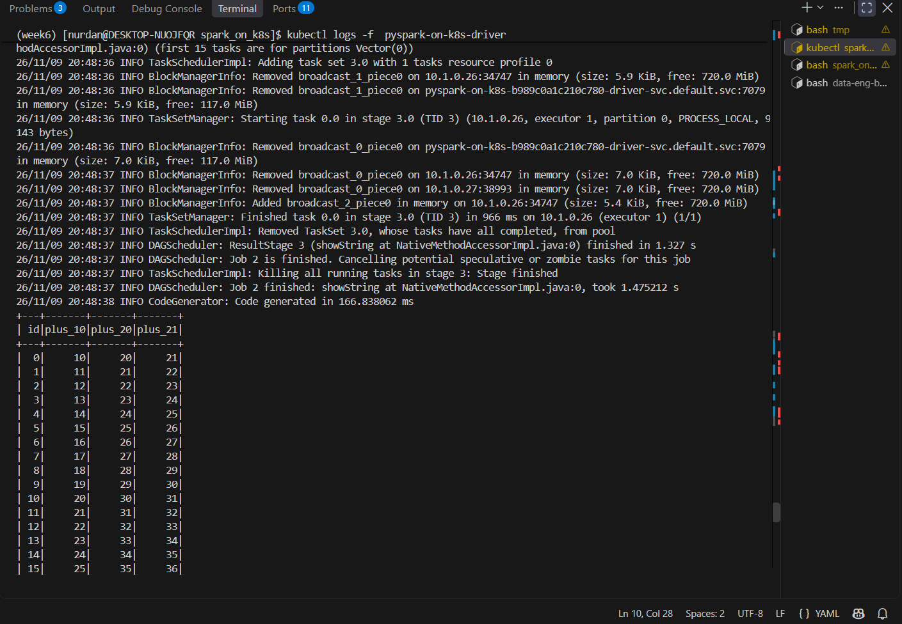

**Conceptual separation:**

- **Helm** installs and upgrades the Operator.
- **Spark Operator** observes and manages `SparkApplication` resources.
- **Driver** plans tasks and manages Executor execution.
- **Executors** perform the distributed calculations.

## 5. OpenShift — Lesson Reference

OpenShift is a Kubernetes-based enterprise application platform. The lesson also covered deploying Spark on OpenShift Local (CRC):

- `oc` is the OpenShift CLI; many standard Kubernetes commands also work through `oc`.
- An OpenShift **Project** is built on a Kubernetes Namespace.
- **BuildConfig** and **ImageStream** provide a workflow for building and referencing application images in the OpenShift internal registry.
- The lesson's `spark-submit-pod.yaml` starts a submission Pod **inside** the cluster, using `k8s://https://kubernetes.default.svc:443`; this avoids needing a local `kubectl proxy` for that submission path.

Example lesson commands:

```bash
oc new-project spark-demo
oc apply -f build.yaml
oc start-build spark-app --from-dir=. --follow
oc get imagestreamtag
oc create -f spark-submit-pod.yaml
oc get pods -w
```

**Scope note:** This section describes the **provided OpenShift lesson example**, not a verified OpenShift Local deployment on this computer. The Windows 10 Home edition shown during study did not meet the Hyper-V/Windows requirements of the provided CRC-on-Windows walkthrough.

See [OpenShift lesson guide](04_kubernetes/04_spark_on_openshift.md) and [WSL notes](04_kubernetes/05_spark_on_openshift_wsl.md).

## 6. Week 9 Homework — Spark on Kubernetes

**Objective:** Submit a Spark application to the Docker Desktop Kubernetes cluster in **cluster deploy mode**, show at least two Executor Pods running, print 50 rows and the student's full name in Driver logs, and verify Driver completion.

**Homework implementation:**

- Python application: [`homework/spark_on_k8s_hw.py`](homework/spark_on_k8s_hw.py)
- Dockerfile: [`homework/Dockerfile`](homework/Dockerfile)
- Submission report (commands, full code, results and evidence): **[`homework/spark_on_k8s_hw_solution.md`](homework/spark_on_k8s_hw_solution.md)**
- Image: `spark-k8s-hw:3.5.3` based on `spark:3.5.3-java17`
- Cluster: Docker Desktop Kubernetes, `docker-desktop`, Node `Ready`
- ServiceAccount: `default:spark`, authorized to create Pods
- Requested Executors: **2**

> **Version note:** The homework uses a Spark 3.5.3 runtime image, while the existing WSL submission executable was from Spark 4.1.4. This reflects the exercise environment; using matching submission/runtime versions is recommended for a reproducible setup.

### Evidence collected

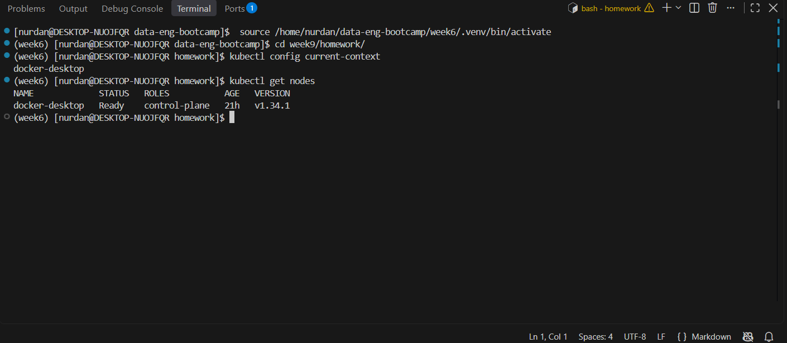

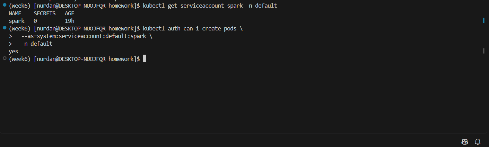

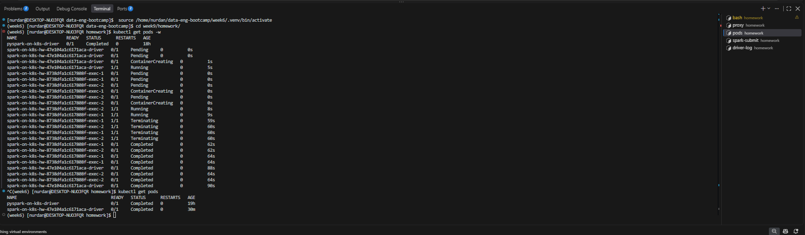

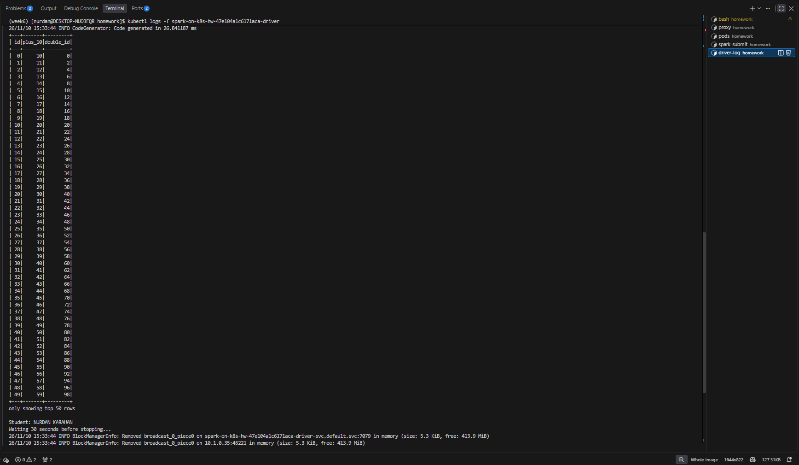

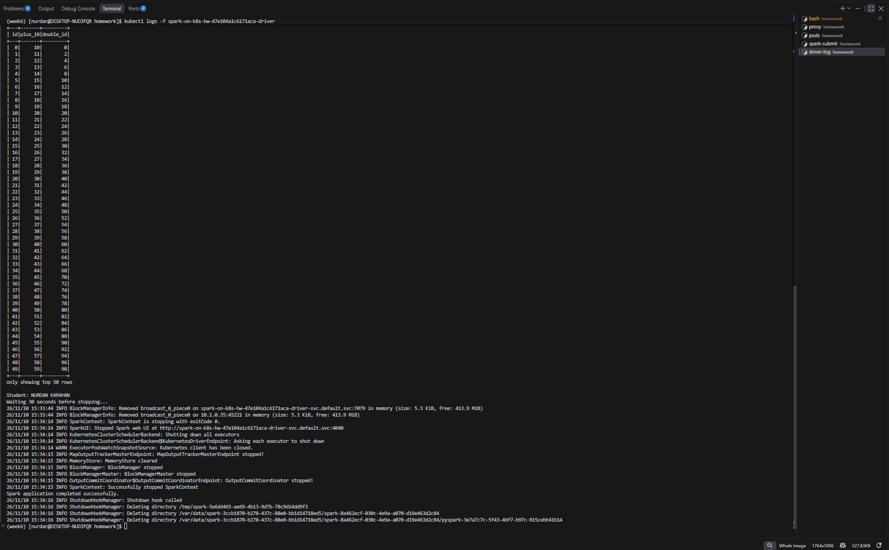

Additional evidence: [`05-driver-log-beginning.png`](homework/screenShots/05-driver-log-beginning.png) and [`07-spark-submit-running.png`](homework/screenShots/07-spark-submit-running.png).

For all commands and the full assignment submission, see the **[homework solution](homework/spark_on_k8s_hw_solution.md)**.

## 7. Common Issues and Lessons Learned

| Issue | Root cause / lesson |
|---|---|
| Master UI Kill button returned HTTP 405 | A nested UI path led to a wrong relative `app/kill/` URL; the direct `http://localhost:8080/` page worked. |
| `localhost:4041` did not show Driver UI | An idle `spark-client` container does not automatically run a Driver or serve Spark UI. |
| Executors were `Running` but no tasks were accepted | Kubernetes Pod state alone does not prove successful Executor registration with the Driver. |
| Executor connection to `172.20.119.128:7078` timed out | WSL2 Driver hostname/IP was not reachable as advertised; a reachable host address was required. |
| `No FileSystem for scheme "local"` | Used `local:///` incorrectly with a WSL directory in client mode. |
| Operator admission webhook refused connection | The Webhook service was not yet ready for requests; retry succeeded after readiness. |
| JupyterLab installation disappeared after recreation | Container writable layers are ephemeral; use a mounted volume or custom image. |

## 8. Key Takeaways

1. **Deploy mode** decides where the Spark Driver runs; **cluster manager** decides how resources are managed.
2. Worker containers can be horizontally scaled; the number of Workers is not necessarily the number of Executors.
3. Spark Connect moves the Driver into the server environment and provides a thin gRPC client.
4. On Kubernetes, Driver and Executors run as Pods in cluster mode, and ServiceAccount/RBAC permissions matter.
5. A Helm-installed Spark Operator can manage repeated Spark application submissions using custom resources.
6. OpenShift extends Kubernetes workflows with its `oc` CLI, Projects and integrated build/image-management features.

## References

- [Apache Spark Documentation](https://spark.apache.org/docs/latest/)
- [Spark on Kubernetes](https://spark.apache.org/docs/latest/running-on-kubernetes.html)
- [Spark Connect Overview](https://spark.apache.org/docs/latest/spark-connect-overview.html)
- [Kubernetes Pods](https://kubernetes.io/docs/concepts/workloads/pods/)
- [Helm Documentation](https://helm.sh/docs/)
- [Kubeflow Spark Operator](https://www.kubeflow.org/docs/components/spark-operator/)
- [OpenShift Documentation](https://docs.redhat.com/en/documentation/openshift_container_platform/)

---

**Author:** Nurdan Karahan · **Course:** Data Engineering Bootcamp (Week 9)
