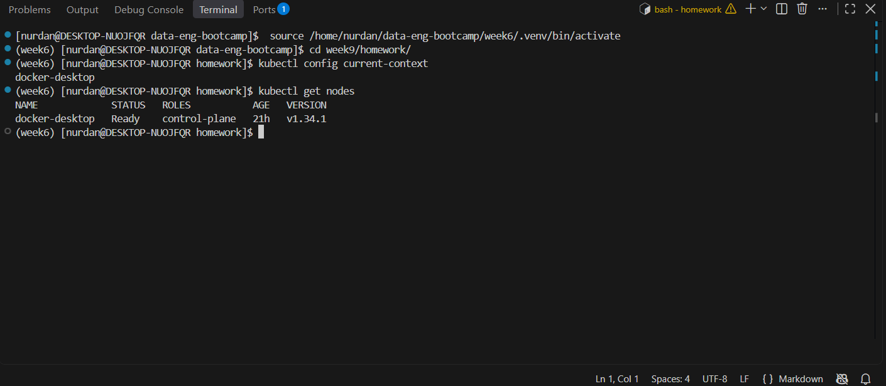
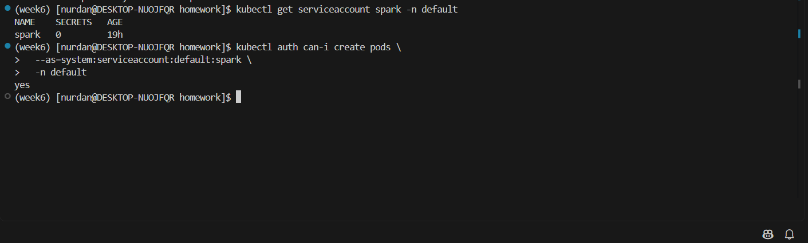
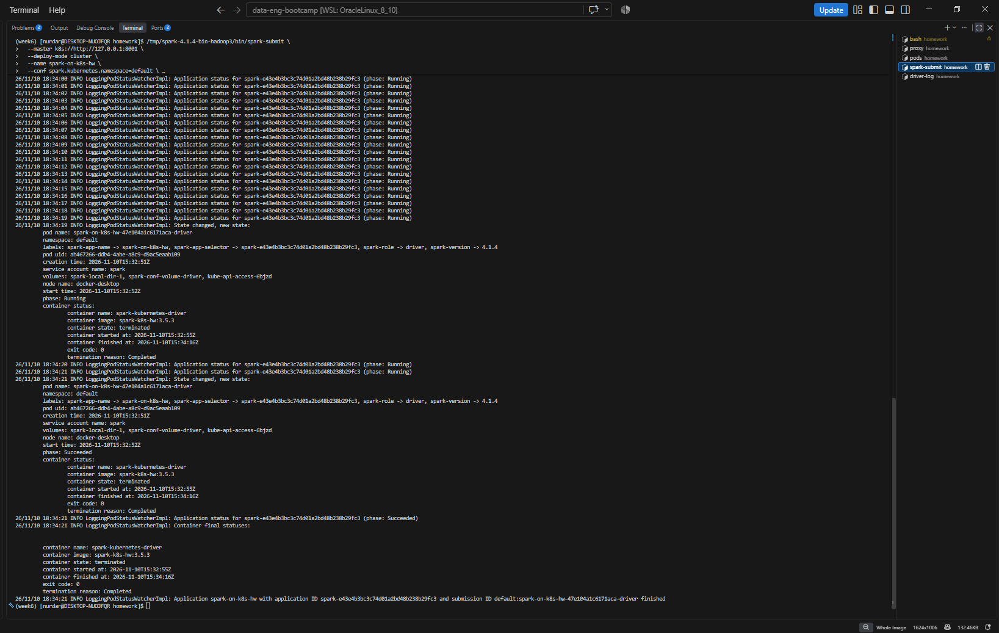
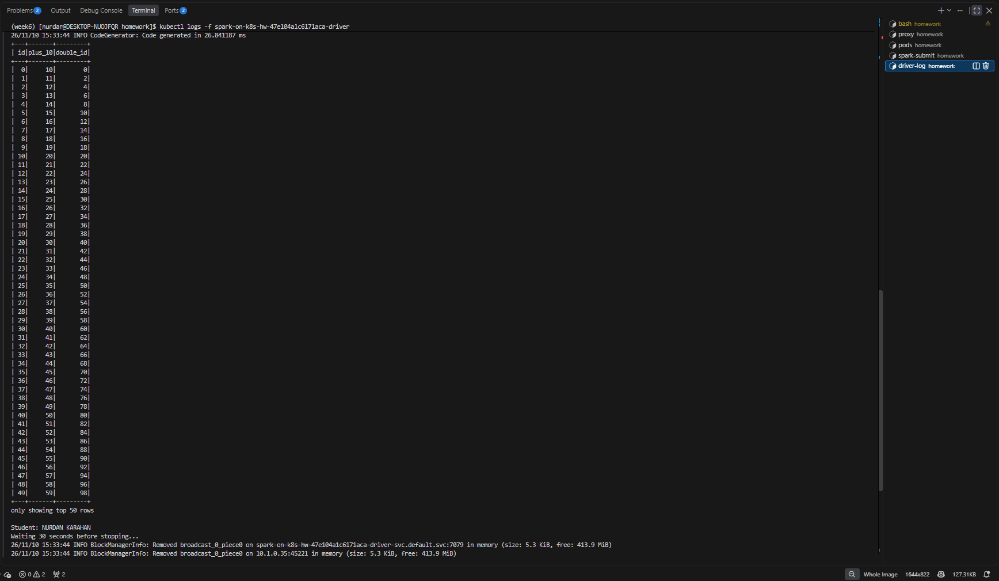
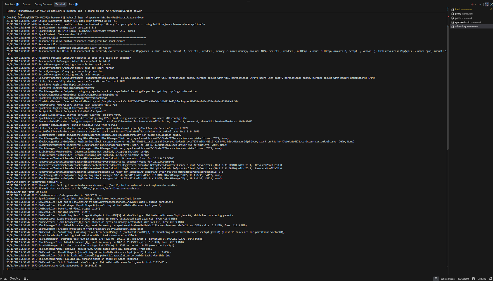
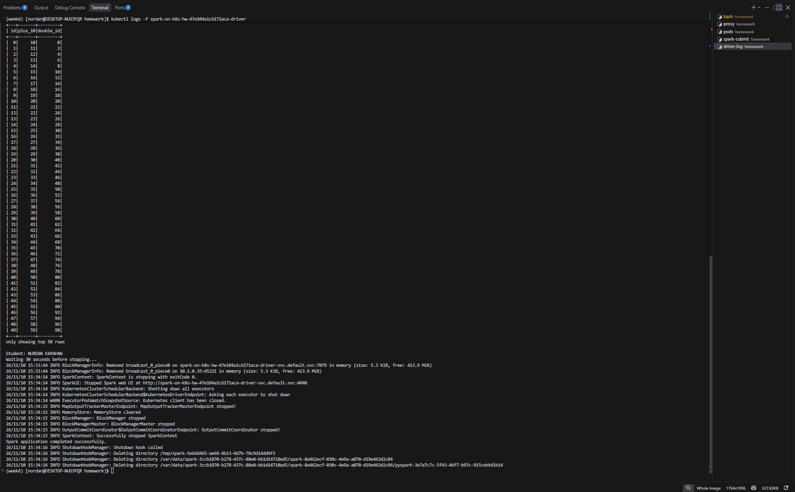
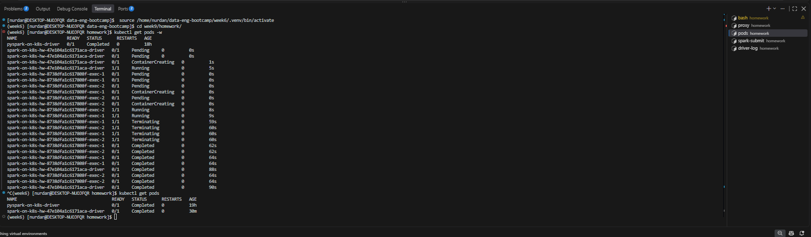

# Week 9 Homework — Run a Spark Application on Kubernetes

**Student:** Nurdan Karahan  
**Course:** Data Engineering Bootcamp — Week 9  
**Instructor:** Erkan Şirin  
**Submission:** `spark_on_k8s_hw_solution.md`

## Objective

Run a PySpark application on the **Docker Desktop Kubernetes** cluster in **cluster deploy mode**, verify that one Driver Pod and at least two Executor Pods run successfully, inspect the Driver logs, and verify that the Driver Pod finishes in the `Completed` state.

**Environment used in this exercise**

| Component | Version / Configuration |
|---|---|
| Kubernetes | Docker Desktop, single-node cluster (`docker-desktop`) |
| Kubernetes version | `v1.34.1` |
| Namespace | `default` |
| ServiceAccount | `default:spark` |
| Application image | `spark-k8s-hw:3.5.3`, based on `spark:3.5.3-java17` |
| Local submission binary | `/tmp/spark-4.1.4-bin-hadoop3/bin/spark-submit` |
| Deployment mode | `cluster` |
| Requested Executor Pods | `2` |

> **Version note:** The exercise image uses Spark **3.5.3 / Java 17**, as specified in the homework, while the existing local `spark-submit` installation is **4.1.4**. This documents the environment actually used in the exercise, rather than silently changing versions. Matching Spark submission and runtime versions is recommended for repeatability; if this mixed-version setup causes issues on another machine, use a matching 3.5.3 submission binary.

## 1. Kubernetes Cluster Preparation and RBAC

The Docker Desktop Kubernetes cluster had already been enabled in the Docker Desktop settings. The existing `default` namespace was used, rather than creating a separate namespace.

The following commands were run from WSL, in the `week9/homework` directory, to verify the cluster:

```bash
kubectl config current-context
kubectl get nodes
kubectl get serviceaccount spark -n default
kubectl auth can-i create pods \
  --as=system:serviceaccount:default:spark \
  -n default
```

The observed results included:

```text
docker-desktop

NAME             STATUS   ROLES           AGE   VERSION
docker-desktop   Ready    control-plane   21h   v1.34.1

NAME    SECRETS   AGE
spark   0         19h

yes
```

The `spark` ServiceAccount and its RBAC permissions had been configured earlier during the live Kubernetes exercises. Their original creation commands were:

```bash
kubectl create serviceaccount spark

kubectl create clusterrolebinding spark-role \
  --clusterrole=edit \
  --serviceaccount=default:spark \
  --namespace=default
```

> **RBAC scope:** `ClusterRoleBinding` grants the selected `ClusterRole` at cluster scope, even when the referenced ServiceAccount belongs to `default`. For namespace-scoped access, prefer a `RoleBinding` in a real deployment.





## 2. Full PySpark Application — `spark_on_k8s_hw.py`

The following script generates **1,000 rows** with `spark.range(1000)`, adds two derived columns, prints **50 rows** and the student's full name in the Driver logs, waits for **30 seconds**, and then calls `spark.stop()`.

```python
import time
from pyspark.sql import SparkSession
from pyspark.sql.functions import col


def main():
    spark = (
        SparkSession.builder
        .appName("Spark on K8s HW")
        .getOrCreate()
    )

    print("Starting Spark on Kubernetes homework...", flush=True)

    # Generate 1,000 rows
    df = spark.range(1000)

    # Add two derived columns
    df = (
        df.withColumn("plus_10", col("id") + 10)
          .withColumn("double_id", col("id") * 2)
    )

    # Display the first 50 rows in the driver logs
    print("Displaying the first 50 rows:", flush=True)
    df.show(50)

    # Print student information
    print("Student: NURDAN KARAHAN", flush=True)

    # Keep the Spark application alive for screenshots
    print("Waiting 30 seconds before stopping...", flush=True)
    time.sleep(30)

    spark.stop()
    print("Spark application completed successfully.", flush=True)


if __name__ == "__main__":
    main()
```

A syntax check can be performed without starting a Spark application:

```bash
python -m py_compile spark_on_k8s_hw.py
```

## 3. Docker Image and Kubernetes Submission

### 3.1. Dockerfile

The application is included inside the image so that the **Driver Pod** can access the Python file in cluster mode.

```dockerfile
FROM spark:3.5.3-java17

USER root

# Create the application directory
RUN mkdir -p /opt/spark/work-dir/app

# Copy the PySpark homework application
COPY --chown=spark:spark spark_on_k8s_hw.py /opt/spark/work-dir/app/spark_on_k8s_hw.py

USER spark
```

Build and verify the image:

```bash
cd ~/data-eng-bootcamp/week9/homework

docker build -t spark-k8s-hw:3.5.3 .
docker images spark-k8s-hw

docker run --rm \
  --entrypoint ls \
  spark-k8s-hw:3.5.3 \
  -l /opt/spark/work-dir/app/
```

The image verification returned:

```text
REPOSITORY     TAG       IMAGE ID       CREATED          SIZE
spark-k8s-hw   3.5.3     2096678243e7   17 seconds ago   1.85GB

total 4
-rw-r--r-- 1 spark spark 946 Nov 10 15:09 spark_on_k8s_hw.py
```

### 3.2. Kubernetes API proxy

In a separate terminal, the local Kubernetes API proxy was run (if an existing proxy was already active on port 8001, it was reused):

```bash
kubectl proxy --port=8001
```

A second terminal can check it with:

```bash
curl http://127.0.0.1:8001/version
```

### 3.3. Spark Submit — Cluster Mode

The application was submitted using the locally installed Spark binary and the custom image:

```bash
/tmp/spark-4.1.4-bin-hadoop3/bin/spark-submit \
  --master k8s://http://127.0.0.1:8001 \
  --deploy-mode cluster \
  --name spark-on-k8s-hw \
  --conf spark.kubernetes.namespace=default \
  --conf spark.kubernetes.container.image=spark-k8s-hw:3.5.3 \
  --conf spark.kubernetes.container.image.pullPolicy=IfNotPresent \
  --conf spark.kubernetes.authenticate.driver.serviceAccountName=spark \
  --conf spark.executor.instances=2 \
  --conf spark.driver.memory=1g \
  --conf spark.executor.memory=1g \
  local:///opt/spark/work-dir/app/spark_on_k8s_hw.py
```

- `--deploy-mode cluster` runs the **Driver inside Kubernetes**, not in the WSL client.
- `spark.executor.instances=2` requests **two Executor Pods**.
- `local:///...` refers to the Python application **inside the container image**.
- `spark.kubernetes.authenticate.driver.serviceAccountName=spark` makes the Driver use the configured ServiceAccount when managing Executor Pods.



## 4. Driver-Side Output — First 50 Rows

The application prints the following columns: `id`, `plus_10 = id + 10`, and `double_id = id * 2`.

The table below reproduces the **first 50 values implied by the submitted Python code**; the actual Driver output is documented in the screenshot. This table is not presented as a verbatim copy of an unavailable text log.

```text
+---+-------+---------+
| id|plus_10|double_id|
+---+-------+---------+
|  0|     10|        0|
|  1|     11|        2|
|  2|     12|        4|
|  3|     13|        6|
|  4|     14|        8|
|  5|     15|       10|
|  6|     16|       12|
|  7|     17|       14|
|  8|     18|       16|
|  9|     19|       18|
| 10|     20|       20|
| 11|     21|       22|
| 12|     22|       24|
| 13|     23|       26|
| 14|     24|       28|
| 15|     25|       30|
| 16|     26|       32|
| 17|     27|       34|
| 18|     28|       36|
| 19|     29|       38|
| 20|     30|       40|
| 21|     31|       42|
| 22|     32|       44|
| 23|     33|       46|
| 24|     34|       48|
| 25|     35|       50|
| 26|     36|       52|
| 27|     37|       54|
| 28|     38|       56|
| 29|     39|       58|
| 30|     40|       60|
| 31|     41|       62|
| 32|     42|       64|
| 33|     43|       66|
| 34|     44|       68|
| 35|     45|       70|
| 36|     46|       72|
| 37|     47|       74|
| 38|     48|       76|
| 39|     49|       78|
| 40|     50|       80|
| 41|     51|       82|
| 42|     52|       84|
| 43|     53|       86|
| 44|     54|       88|
| 45|     55|       90|
| 46|     56|       92|
| 47|     57|       94|
| 48|     58|       96|
| 49|     59|       98|
+---+-------+---------+
only showing top 50 rows
```



The start of the Driver log is also included for execution context:



## 5. Driver Log — Full Name and Completion Evidence

The application explicitly writes the following line to stdout so that it appears in the Driver log:

```text
Student: NURDAN KARAHAN
```

The `06-driver-completed.png` screenshot was selected because it shows **both the full name and the Driver Pod's `Completed` status**.



## 6. Kubernetes Pod Status and Cleanup

### 6.1. Driver and Executor Pods while the application is running

In a separate terminal, the Pod lifecycle was monitored:

```bash
kubectl get pods -w
```

The following screenshot records the actual Pod names and their states, showing the Driver Pod and **at least two Executor Pods** in `Running` state:



To obtain the Driver logs while the Pod is present:

```bash
DRIVER_POD=$(kubectl get pods -n default \
  -l spark-role=driver \
  -o jsonpath='{.items[0].metadata.name}')

kubectl logs -n default "$DRIVER_POD"
```

### 6.2. Completed Driver and Executor cleanup

After the job finishes, the application calls `spark.stop()`. Kubernetes should report the Driver Pod as `Completed` and Executor Pods should have been removed:

```bash
kubectl get pods -n default
```

The observed completion status is recorded in the screenshot already linked in **Section 5** (`06-driver-completed.png`). This image also contains the full-name evidence.

The finished Driver Pod can be deleted *after* taking screenshots and collecting logs:

```bash
# Optional cleanup after verifying evidence
kubectl delete pod -n default -l spark-role=driver
```

If the Docker Desktop Kubernetes cluster is no longer needed, it can be stopped in Docker Desktop settings. Stopping the whole cluster is optional and was not required for the assignment evidence.

## Verification Checklist

- [x] Used Docker Desktop Kubernetes with the node in `Ready` state.
- [x] Verified `spark` ServiceAccount and Pod creation permission.
- [x] Prepared a custom Spark image with `spark_on_k8s_hw.py` inside it.
- [x] Submitted Spark to Kubernetes in `cluster` mode.
- [x] Requested two Executor Pods and documented running Pod evidence.
- [x] Generated 1,000 rows with `spark.range(1000)` and two derived columns.
- [x] Invoked `df.show(50)` and documented the Driver output.
- [x] Printed student full name to Driver stdout.
- [x] Waited 30 seconds before `spark.stop()`.
- [x] Captured completion evidence and documented post-run checks.

## Project Layout

```text
week9/
├── 03_standalone/
├── 04_kubernetes/
├── homework/
│   ├── Dockerfile
│   ├── spark_on_k8s_hw.py
│   ├── spark_on_k8s_hw_solution.md
│   └── screenShots/
│       ├── 01-cluster-ready.png
│       ├── 02-serviceaccount-rbac.png
│       ├── 03-driver-executors-running.png
│       ├── 04-driver-log-50-rows.png
│       ├── 05-driver-log-beginning.png
│       ├── 06-driver-completed.png
│       └── 07-spark-submit-running.png
└── screenShots/   # Week 9 lecture screenshots (separate from homework)
```
